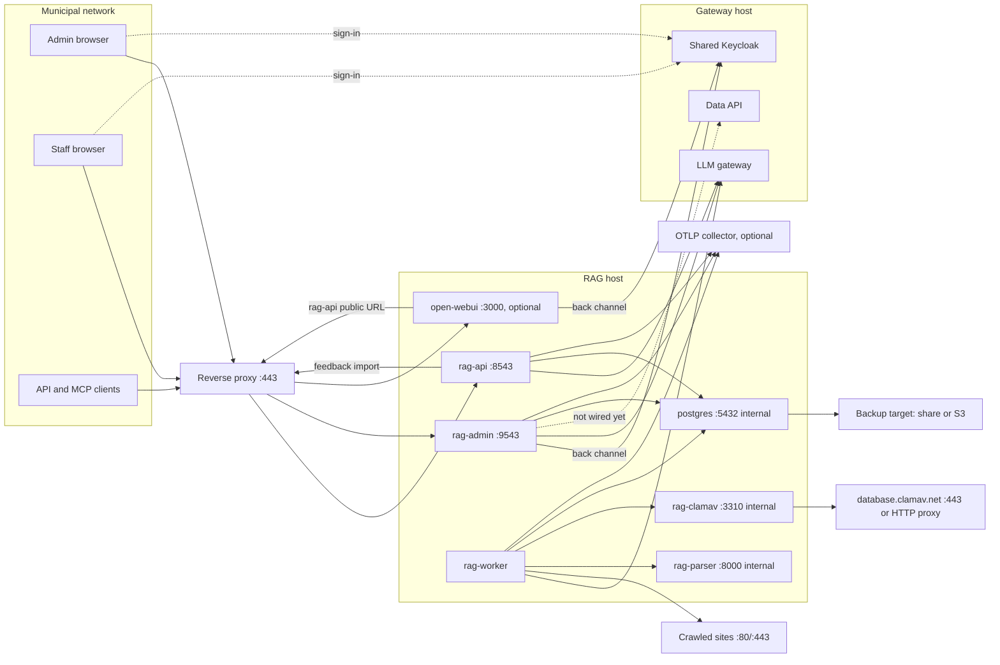

# Network and ports

This page is for the infrastructure and security teams that open ports and write firewall and proxy rules for
Ume.Rag. It lists every listener, every outbound destination and every container-internal port, per supported setup,
and says where each one is configured. Each rule cites the file it comes from. Where the repository doesn't set a
value, the page says **not set by Ume.Rag; agree with infra**.

Installation is in [production-setup.md](production-setup.md), operation (including the host firewall's commands) in
the [runbook](runbook.md), the units on the host in [`deploy/host/README.md`](../deploy/host/README.md). The design is
[`plans/platform/repo-and-deployment.md`](../plans/platform/repo-and-deployment.md) §6.1 (networks) and
[`plans/identity/design.md`](../plans/identity/design.md) (sign-in flows).

Everything is IPv4: the Compose networks have no IPv6 (`deploy/host/docker-user-firewall.sh`).

## 1. Components and hosts

| Component | Where | What it is to Ume.Rag |
|---|---|---|
| **RAG host** | one Linux host, Docker Compose project `ume-rag` | `postgres`, `rag-api`, `rag-admin` (`deploy/compose.prod.yaml`); `rag-worker`, `rag-parser`, `rag-clamav` (`deploy/compose.ingestion.yaml`); optionally `open-webui` (`deploy/compose.openwebui.yaml`, its own project `ume-rag-openwebui`) |
| **Gateway host** | the LLM gateway's host, run by the gateway team | the gateway (every model call), its Data API (catalogue for the admin's sync), and in the pilot the **shared Keycloak** (realm `ume`). Ume.Rag reaches each by URL only |
| **Municipal reverse proxy** | in front of the RAG host (and the gateway host) | terminates public TLS and re-encrypts to the RAG listeners (`init-deployment.sh --proxy`) |
| **Identity provider** | the shared Keycloak (pilot), a standalone Keycloak, or Entra ID / AD FS directly | OIDC for the admin UI and Open WebUI |
| **Crawled sites** | municipal hosts (private ranges) and public web sites | read by `rag-worker` over HTTP(S) |
| **Backup target** | a share mounted on the RAG host, or an S3-compatible store | pgBackRest repository and the upload copy |
| **ClamAV signatures** | `database.clamav.net` (no internal mirror, Decisions "ClamAV updates"), or through an egress proxy | `freshclam` inside `rag-clamav` |
| **OTLP collector** (optional) | municipal monitoring | logs, metrics and traces of the .NET services |

The gateway repository publishes its own services on loopback by default and serves them through its proxy:
gateway `8443`, admin `9443`, Data API `10443` (gateway repo `deploy/compose.prod.yaml`), Keycloak `11443` (gateway repo
`deploy/keycloak/compose.yaml`). RAG's listeners use `8543` and `9543` so both stacks fit on one host
([gateway-host-setup.md](gateway-host-setup.md#4-preflight-checks-read-only), step 4.3). The ports RAG connects to
are the ones in the URLs it is given, not these.



## 2. Inbound to the RAG host

Only three ports are published (`deploy/compose.prod.yaml`, `deploy/compose.openwebui.yaml`; repo-and-deployment
§6.1: "Nothing else is published").

| Listener | Host port (default) | Container port | Protocol | Who connects | Purpose | Required | Configured by |
|---|---|---|---|---|---|---|---|
| `rag-api` | `${UME_RAG_API_BIND}:${UME_RAG_API_PORT}`, `127.0.0.1:8543` | 8443 | HTTPS (TLS: internal CA, or your PKI with `--api-cert`/`--api-key`) | the reverse proxy only, on behalf of: Open WebUI, API and MCP clients with `ume-rag-sk-` keys, staff browsers following citation download links | chat, retrieval, MCP (`Rag__Roles: knowledge,chat,mcp`), health | yes | `--api-port`, `--bind`, `--proxy` (`deploy/init-deployment.sh`) |
| `rag-admin` | `${UME_RAG_ADMIN_BIND}:${UME_RAG_ADMIN_PORT}`, `127.0.0.1:9543` | 8443 | HTTPS (as above, `--admin-cert`/`--admin-key`) | the reverse proxy only, on behalf of admins' browsers | admin UI and its BFF, OIDC redirects `/signin-oidc` and `/signout-callback-oidc`, uploads, health | yes | `--admin-port`, `--bind`, `--proxy` |
| `open-webui` | `${UME_RAG_OPENWEBUI_BIND}:${UME_RAG_OPENWEBUI_PORT}`, `127.0.0.1:3000` | 8080 | **plain HTTP**: the proxy terminates TLS | the reverse proxy only, on behalf of staff browsers and rag-api's feedback import | the chat UI, OIDC callback `/oauth/oidc/callback` | optional | `UME_RAG_OPENWEBUI_PORT` in `deploy/.env` (written as 3000), bind as the listeners' |

**Binding.** By default all three bind to `127.0.0.1`, so nothing is reachable from off the host. With `--proxy` they
bind to `0.0.0.0` (`deploy/init-deployment.sh`: "binds the listeners to 0.0.0.0 (firewall them to the proxy)"), and
**all three must be reachable only from the reverse proxy**. `--bind ADDR` binds them to one address instead.

**How to restrict them.** Docker publishes these ports with DNAT, so the connections pass the `FORWARD` chain and
Docker's `DOCKER-USER` chain, not the host's `INPUT` chain: an `INPUT` rule (ufw, firewalld zones) does not restrict
them. `deploy/host/docker-user-firewall.sh` doesn't either; it handles only traffic that the RAG containers start.
Restrict the ports in a network firewall in front of the host, or with `DOCKER-USER` rules that match the original
port, for example:

```bash
iptables -I DOCKER-USER -p tcp -m conntrack --ctstate NEW --ctorigdstport 8543 ! -s <proxy address> -j DROP
iptables -I DOCKER-USER -p tcp -m conntrack --ctstate NEW --ctorigdstport 9543 ! -s <proxy address> -j DROP
iptables -I DOCKER-USER -p tcp -m conntrack --ctstate NEW --ctorigdstport 3000 ! -s <proxy address> -j DROP
```

Ume.Rag ships no such rule and doesn't keep it across reboots: how it is installed is not set by Ume.Rag; agree with
infra.

**Proxy routes.** `init-deployment.sh --proxy` prints them: `https://<api host>` to `https://<upstream host>:8543` and
`https://<admin host>` to `https://<upstream host>:9543`, keeping the `Host` header; `client_max_body_size 60m` and
`proxy_request_buffering off` on `PUT /api/upload-batches/{batchId}/files/{n}` of the admin host, 1 MB elsewhere. The
proxy must trust the listeners' certificates (`deploy/certs/ca.pem`, or your PKI), and set `X-Forwarded-For`; add its
addresses to the trusted proxies in the admin UI (Settings, *Network*) so key IP allow-lists and security events see
the client's address ([production-setup.md](production-setup.md#reverse-proxy-and-pki)). Which rag-api paths the proxy
exposes to whom (identity design §5.3): `GET /v1/documents/*` and `GET /v1/documents/*/content` to the staff network
(citation downloads); every other path only to the Open WebUI host and the integration clients you have agreed.
Open WebUI's route is `https://<owui host>` to `http://<upstream host>:3000`.

**Monitoring.** No metrics port is published. Health is `/health/live`, `/health/ready` and `/version` on the two
listeners (through the proxy, or on the host with `curl --cacert deploy/certs/ca.pem https://localhost:8543/...`).
The backup scripts write Prometheus text files to `/var/lib/ume-rag/` for a local collector (`deploy/host/README.md`);
that collector's port (for example node_exporter's) is not set by Ume.Rag; agree with infra. Telemetry is pushed out
over OTLP (§3), never scraped.

**Host administration** (SSH and the like) is not set by Ume.Rag; agree with infra.

## 3. Outbound

### 3.1 Per Docker network

Each Compose network has a fixed subnet, and `deploy/host/docker-user-firewall.sh` (run by `rag-firewall.service`
after Docker starts and by `rag-firewall.timer` every 15 minutes) gives each one an allow-list in chain
`UME-RAG-EGRESS`, jumped to from `DOCKER-USER`. A container sends all its egress through the network that holds its
default route, pinned with `gw_priority` in the Compose files: rag-api and rag-admin leave through `llm`, rag-worker
through `crawl`. Destinations are host names resolved when the script runs; the port is the URL's (443 for `https://`
without a port, 80 for `http://`), and an allow-listed endpoint is matched both by address and port and, when it is
published on the RAG host itself, by its original destination (`--ctorigdst`). Everything else from a network is
rejected (`icmp-admin-prohibited`). New connections from any RAG subnet to the host's own addresses are rejected in
chain `UME-RAG-INPUT`, except allow-listed endpoints that resolve to the host (a gateway or Keycloak on the same
machine).

| Network (subnet) | Members | Destination | Port, protocol | Purpose | When | Config key |
|---|---|---|---|---|---|---|
| `llm` (172.30.3.0/24) | rag-api, rag-admin (default route); rag-worker is a member but leaves through `crawl` | the gateway, host of `UME_RAG_GATEWAY_URL` | the URL's port (443), HTTPS | every model call: chat, embeddings, rerank, model checks | always | `--gateway-url` → `Gateway__BaseUrl` |
| | | the OIDC authority, host of `UME_RAG_OIDC_AUTHORITY` | the URL's port (443), HTTPS | rag-admin's back channel: discovery, JWKS, token endpoint (code + PKCE). rag-api validates no OIDC tokens yet (`RagApi:Authority` is not built, identity design §7.1) | always | `--oidc-authority` → `Oidc__Authority` |
| | | the Open WebUI host, `UME_RAG_OPENWEBUI_HOST` | 443, HTTPS, through the reverse proxy | rag-api's feedback import (`OpenWebUi__BaseUrl` = `https://<owui host>`) | with Open WebUI | `--openwebui-host` |
| | | the OTLP endpoint, `UME_RAG_OTEL_ENDPOINT` | the URL's port, HTTP(S) | telemetry | optional | set by hand in `deploy/.env` |
| | | DNS: the host's upstream resolvers | 53, UDP and TCP | name resolution through Docker's embedded DNS | always | `--dns IP` overrides |
| `crawl` (172.30.6.0/24) | rag-worker (default route) | the gateway | the URL's port (443), HTTPS | embeddings, evaluation models, catalogue | with the ingestion overlay | `--gateway-url` |
| | | the OTLP endpoint | the URL's port | telemetry | optional | `UME_RAG_OTEL_ENDPOINT` |
| | | `UME_RAG_CRAWL_ALLOW` (CIDRs) | any port, any protocol | municipal hosts in private ranges | when crawling municipal hosts | `--crawl-allow` → also `Crawl__AllowedPrivateRanges` |
| | | every other private, loopback, link-local, CGNAT, documentation, multicast or reserved range | – | rejected | – | list in `docker-user-firewall.sh` (`private=`) |
| | | the rest of the Internet | any at the firewall; the worker itself fetches only `http`/`https` on 80 and 443 plus `Settings.Crawl.AllowedPorts` | public sites being crawled | with the ingestion overlay | `Settings.Crawl.AllowedPorts` (admin UI, run-time) |
| | | DNS | 53, UDP and TCP | | always | |
| `mirror` (172.30.7.0/24) | rag-clamav (freshclam) | `database.clamav.net` | 443, HTTPS | signature updates, four times a day | with the ingestion overlay, no proxy | `images/clamav/freshclam.conf` (`DatabaseMirror`) |
| | | **or only** freshclam's HTTP proxy, `UME_RAG_FRESHCLAM_PROXY` | the given `HOST:PORT` | the same through the proxy | with `--freshclam-proxy` | `--freshclam-proxy` |
| | | DNS | 53, UDP and TCP | | always | |
| `backup` (172.30.16.0/24) | postgres (pgBackRest) | the S3 endpoint, `UME_RAG_BACKUP_ENDPOINT` | 443 unless the endpoint names a port, HTTPS | WAL archive and backups | with an `s3://` target | `--backup-target s3://ENDPOINT/BUCKET[/PATH]` |
| | | nothing (all rejected) | – | a mounted share is written through the file system | with a share or `local` | `--backup-target DIR` |
| | | DNS | 53 | | with an `s3://` target | |
| `openwebui` (172.30.17.0/24) | open-webui | rag-api's public URL, `UME_RAG_API_PUBLIC_URL` | its port (443 behind the proxy), HTTPS | Open WebUI's one model connection (`OPENAI_API_BASE_URLS`) | with Open WebUI | `--api-host`, `--proxy` |
| | | the OIDC provider, `UME_RAG_OPENWEBUI_OIDC_PROVIDER_URL` | its port (443), HTTPS | Open WebUI's back channel: discovery, token, JWKS | with Open WebUI | `--openwebui-oidc-provider-url` (default: the authority's discovery document) |
| | | DNS | 53 | | with Open WebUI | |
| `edge` (172.30.1.0/24) | rag-api, rag-admin | nothing | – | carries the published ports only | – | – |
| `data` (172.30.2.0/24), `ingestion` (172.30.4.0/24), `parser` (172.30.5.0/24) | see §4 | nothing (Docker `internal: true`, and rejected) | – | – | – | – |

Sources: `deploy/host/docker-user-firewall.sh` (allow-lists, DNS, `private=`, `INPUT`), `deploy/compose.prod.yaml`,
`deploy/compose.ingestion.yaml`, `deploy/compose.openwebui.yaml` (members, subnets, `gw_priority`),
`src/Ume.Rag.Worker/Connectors/Egress/EgressGuard.cs` (schemes and ports of the crawler).

**The Data API is not wired yet.** The admin's organisation and model catalogue sync call the gateway's Data API at
`OrgSync:BaseUrl` (`src/Ume.Rag.AdminApi/OrganisationSync.cs`; a host of its own, gateway default port 10443,
[p1a-local-run.md](p1a-local-run.md) §4.2). The production Compose files don't set `OrgSync__BaseUrl` and the firewall
has no entry for it, so both syncs are off in a Compose deployment. Once it is wired, `llm` needs
`<data api host>:<port>` (`--allow llm=<data api host>:<port>` until then).

### 3.2 From the host itself

These leave from the host, not from a Compose network, so `docker-user-firewall.sh` doesn't filter them. Ports and
rules are not set by Ume.Rag; agree with infra:

- the backup share mounted on the host (`UME_RAG_BACKUP_DIR`, `UME_RAG_UPLOAD_BACKUP_DIR`), with its protocol (NFS,
  SMB);
- image pulls by Docker: the release's images are on `ghcr.io` (`ghcr.io/<owner>/ume-rag/<service>`), and the Open
  WebUI image is `ghcr.io/open-webui/open-webui` (`deploy/compose.openwebui.yaml`); none if images come from an
  internal registry;
- the release bundle from GitHub releases ([production-setup.md](production-setup.md#1-files-and-images));
- DNS, NTP and OS updates.

### 3.3 Sign-in: browser flows and back-channel flows

Two kinds of traffic reach the identity provider, from different places:

| Flow | From | To | Port | Notes |
|---|---|---|---|---|
| Admin sign-in (browser) | the admin's browser | the IdP's authorization endpoint (host of `UME_RAG_OIDC_AUTHORITY`), then back to `https://<admin host>/signin-oidc` | 443 | code + PKCE; the IdP must be reachable from the admins' network |
| Admin sign-in (back channel) | rag-admin, network `llm` | the IdP's discovery, JWKS and token endpoints | the authority URL's port | firewall `llm` rule |
| Open WebUI sign-in (browser) | the user's browser | the IdP, then `https://<owui host>/oauth/oidc/callback` | 443 | |
| Open WebUI sign-in (back channel) | open-webui, network `openwebui` | the provider URL's host: discovery, token, JWKS | the provider URL's port | firewall `openwebui` rule |
| Citation downloads (browser) | the user's browser | `https://<api host>/v1/documents/...` (absolute links from `Knowledge__PublicBaseUrl`) | 443 | through the proxy |

rag-api and rag-worker never call the IdP in this release. Open WebUI's user identity reaches rag-api as a JWT signed
with a shared secret (`OpenWebUi__JwtSecret`), not through the IdP (identity design §5.3).

## 4. Internal only

These ports exist only inside Docker networks. None is published on the host, so **none should be opened on any host or
network firewall**. Check with `docker compose --env-file deploy/.env ps` (the `PORTS` column shows only the
listeners of §2) and `ss -ltnp`.

| Container | Port | Protocol | Network | Clients | Source |
|---|---|---|---|---|---|
| `postgres` | 5432 (image default) | PostgreSQL over TLS only (`hostnossl ... reject`), database `ragdb`, the four service roles, `scram-sha-256`; the superuser only over the Unix socket | `data` (internal) | rag-migrate, rag-api, rag-admin, rag-worker (`Host=postgres`, `SSL Mode=VerifyFull`) | `deploy/postgres/pg_hba.conf`, `deploy/postgres/postgresql.conf`, `deploy/init-deployment.sh` |
| `rag-parser` | 8000 | HTTPS (internal CA, name `rag-parser`) | `parser` (internal; its only network) | rag-worker (`Parser__BaseUrl: https://rag-parser:8000`) | `deploy/compose.ingestion.yaml`, `src/parser/Dockerfile` |
| NER (`ner-0`) | – | runs inside the parser container (`/v1/ner` on port 8000), not a container of its own | – | rag-worker | `src/parser/ume_parser/api.py` |
| `rag-clamav` (clamd) | 3310 | TCP, **no TLS and no authentication** | `ingestion` (internal) | rag-worker (`ClamAv__Host: rag-clamav`, `ClamAv__Port: 3310`, INSTREAM) | `images/clamav/clamd.conf` (`TCPSocket 3310`), `deploy/compose.ingestion.yaml` |
| `rag-api`, `rag-admin` | 8443 | HTTPS | `edge`, `data`, `llm` | only through the published host ports of §2 | `deploy/compose.prod.yaml` (`Kestrel__Endpoints__Https__Url`) |
| `rag-worker` | 8443 | HTTPS | `data`, `llm`, `ingestion`, `parser`, `crawl` | none: not published; its health check runs inside the container | `deploy/compose.ingestion.yaml` |
| `open-webui` | 8080 | HTTP | `openwebui` | only through the published host port of §2 | `deploy/compose.openwebui.yaml` |
| `rag-migrate` | – | one-shot client of postgres | `data` | – | `deploy/compose.prod.yaml` |
| `rag-blobs-init`, `rag-upload-backup` | – | no network (`network_mode: none`) | – | – | `deploy/compose.prod.yaml` |
| Redis | – | none in the production Compose files (P2; the dev AppHost starts one only with `Redis:Enabled`) | – | – | `src/Ume.Rag.AppHost/Program.cs` |

Docker keeps the bridge networks apart, and members of one network reach each other on it (the firewall returns
traffic within a subnet). `data`, `ingestion` and `parser` are `internal: true`, so they have no route out at all.

## 5. Per setup

### 5.1 Pilot: shared Keycloak and gateway on the gateway host

Decisions "P1 pilot sign-in" and "Gateway release 1 and shared Keycloak as built": Keycloak runs on the gateway's
host, realm `ume`, and RAG's clients come from `deploy/keycloak/rag-additions.json`.

- `UME_RAG_OIDC_AUTHORITY=https://<keycloak host>/realms/ume`; `UME_RAG_GATEWAY_URL=https://<gateway host>`.
- RAG host egress: `llm` → `<gateway host>:443` and `<keycloak host>:443`; `crawl` → `<gateway host>:443`;
  `openwebui` → `<keycloak host>:443` and the proxy (with Open WebUI). All derived by the firewall from `deploy/.env`.
- Browsers: admins and staff → `<keycloak host>:443` and the proxy's RAG host names.
- The gateway host's own inbound (its proxy, Keycloak's port `11443` on loopback) belongs to the gateway team.
- **RAG on the gateway host itself** ([gateway-host-setup.md](gateway-host-setup.md)): the same rules; when the
  gateway's or Keycloak's name resolves to the host, the firewall's `UME-RAG-INPUT` and `--ctorigdst` exceptions let
  the RAG networks reach them ([gateway-host-setup.md](gateway-host-setup.md#8-host-units-firewall-start), step
  8.1). RAG's `8543`/`9543` don't clash with the gateway's `8443`/`9443`/`10443`/`11443`.

### 5.2 Standalone Ume.Rag with its own Keycloak

Decisions "Identity providers: AD and Entra ID through Keycloak, Ume.Rag standalone later". The repository ships only
the realm file (`deploy/keycloak/standalone/10-rag-realm.json`, applied with keycloak-config-cli as in
[`deploy/keycloak/README.md`](../deploy/keycloak/README.md#standalone)); it has no Compose file for Keycloak. Its
host, port, proxy route and database are **not set by Ume.Rag; agree with infra**.

- Point `UME_RAG_OIDC_AUTHORITY` (and Open WebUI's provider URL, which follows it) at that Keycloak; the firewall
  rules of §3 follow the new host. If it runs on the RAG host and its name resolves there, the `INPUT` exception covers
  it.
- Brokered Entra ID or AD (Keycloak as the broker): RAG's rules don't change. Keycloak's own egress (to
  `login.microsoftonline.com`, AD FS or LDAP) leaves from Keycloak's host: not set by Ume.Rag; agree with infra.

### 5.3 Entra ID or AD FS directly through `Oidc:*`

Switching is configuration, not code (production-setup.md, *Sign-in (OIDC)*).

- **Entra ID:** `--oidc-authority https://login.microsoftonline.com/<tenant>/v2.0`, and for Open WebUI
  `--openwebui-oidc-provider-url https://login.microsoftonline.com/<tenant>/v2.0/.well-known/openid-configuration`
  with client `ume-rag-open-webui` (`deploy/init-deployment.sh`, `deploy/compose.openwebui.yaml`). The firewall then
  allows `login.microsoftonline.com:443` from `llm` and `openwebui`. It is a CDN-served name: the firewall resolves it
  every 15 minutes, and an address change can block sign-in until the next run (`deploy/host/README.md`). The browsers
  need `login.microsoftonline.com` and whatever else Microsoft's sign-in pages load: not set by Ume.Rag; agree with
  infra.
- **AD FS:** the authority is the AD FS issuer URL; the firewall allows its host and port. Its form is not set by
  Ume.Rag; agree with infra.
- The discovery document names the JWKS and token endpoints. If one is on another host than the authority, add it
  with `--allow llm=<host>` (and `--allow openwebui=<host>`).
- **No Microsoft Graph** in this release: Graph comes with P2 for the member-group lookup (repo-and-deployment §6.1,
  identity design §14).
- No Keycloak is needed, and nothing goes to the gateway host's Keycloak.

### 5.4 Open WebUI on the RAG host, or elsewhere

Optional, off by default, started by hand (`deploy/compose.openwebui.yaml`); on the 24 GB host or a VM of its own.

**On the RAG host:** publishes `3000` (bound like the listeners), network `openwebui`. It calls rag-api at
`UME_RAG_API_PUBLIC_URL`, which goes **out through the reverse proxy and back** to `8543`, and rag-api's feedback
import calls `https://<owui host>` through the proxy to `3000`. So the proxy must be reachable from the RAG host on 443,
and the proxy must reach the RAG host on `8543` and `3000`. This needs `--proxy`: without it the public URL is
`https://<api host>:8543`, and the listener is bound to `127.0.0.1`, which the container can't reach.

**On its own VM:** the RAG host's `openwebui` network stays unused; the RAG host still needs `llm` → `<owui host>:443`
for the feedback import. On the VM: inbound `3000` (or its own port) from the proxy only; egress to the proxy (rag-api's
public URL) and the OIDC provider, 443, and DNS. `docker-user-firewall.sh` is written for the RAG host; whether it also
runs on the VM, and with which rules, is not set by Ume.Rag; agree with infra.

Either way, Open WebUI's client in rag-api has `AllowedIpRanges` = the Open WebUI host (identity design §5.3). Through
the proxy, rag-api sees that address only when the proxy is in the trusted proxies and sets `X-Forwarded-For`.

### 5.5 With or without the ingestion overlay

`init-deployment.sh` always lists `compose.prod.yaml` and `compose.ingestion.yaml` in `COMPOSE_FILE`; the pilot runs
both.

- **With it:** the `crawl`, `mirror`, `ingestion` and `parser` rules of §3 and §4 apply: egress to crawled sites, to
  `database.clamav.net` (or the proxy) and to the gateway from `crawl`.
- **Without it** (`docker compose -f deploy/compose.prod.yaml ...`): no rag-worker, parser or ClamAV, so no egress to
  crawled sites or ClamAV, and nothing is ingested. The firewall still writes rules for the unused subnets; they match
  nothing.
- **Ingestion on its own host** (P2, repo-and-deployment §6.4): planned, not built (`compose.ingestion-remote.yaml`
  doesn't exist). It would publish Postgres `5432` on the data host's LAN address for the ingestion host only.

### 5.6 freshclam directly or through a proxy

- **Directly** (default): `mirror` → `database.clamav.net:443`, nothing else.
- **Through a proxy:** `--freshclam-proxy HOST:PORT` writes `HTTPProxyServer`/`HTTPProxyPort` into a copy of
  `freshclam.conf` (`deploy/compose.clamav-conf.yaml`) and the firewall lets `mirror` reach only that proxy. The proxy
  then needs `database.clamav.net:443`. Recommended where IT has an egress proxy (production-setup.md, *ClamAV
  signatures*), since the CDN's addresses change.

### 5.7 Test host

[test-host.md](test-host.md): the same as the pilot, with `--proxy`, `--host-memory 24` and `--freshclam-proxy`.
Listeners on `0.0.0.0:8543` and `0.0.0.0:9543`, restricted to the proxy (§2); its own host names
(`rag-api-test...`, `rag-admin-test...`), redirect URIs, gateway keys and backup path. Egress as §3.

### 5.8 Local development

The Aspire AppHost's ports (services `7401`–`7404`, containers `7410`–`7416`, admin UI `5174`, dashboard `17470`) are
for developers on their own machines and are never opened on a server firewall. See
[local-development.md](local-development.md).

## 6. Checklist for the firewall and proxy request

Replace the placeholders; the RAG host's firewall script derives its own egress rules from `deploy/.env`, so these
are the rules **outside** the host (network firewalls, the proxy) plus the published-port restriction.

```text
Inbound to <rag host>
  [ ] <proxy> -> <rag host>:8543/tcp   HTTPS   rag-api        (only from the proxy)
  [ ] <proxy> -> <rag host>:9543/tcp   HTTPS   rag-admin      (only from the proxy)
  [ ] <proxy> -> <rag host or owui vm>:3000/tcp HTTP  open-webui (optional; only from the proxy)
  [ ] everything else to <rag host> closed, apart from host administration (agree with infra)
  [ ] published ports restricted to <proxy> in DOCKER-USER or a network firewall (not INPUT/ufw)

Reverse proxy
  [ ] https://<api host>   -> https://<rag host>:8543  (Host header kept, X-Forwarded-For set, 1 MB body limit)
        staff network: GET /v1/documents/* and /v1/documents/*/content only
        <owui host> and agreed integration clients: all paths
  [ ] https://<admin host> -> https://<rag host>:9543  (60m and no request buffering on PUT /api/upload-batches/{batchId}/files/{n})
  [ ] https://<owui host>  -> http://<rag host or owui vm>:3000   (optional)
  [ ] the proxy trusts deploy/certs/ca.pem or the PKI certificates of the listeners
  [ ] the proxy's addresses entered as trusted proxies in the admin UI

Outbound from <rag host>
  [ ] -> <gateway host>:<gateway port, 443>/tcp          HTTPS  always
  [ ] -> <oidc authority host>:443/tcp                    HTTPS  always (Keycloak, Entra or AD FS)
  [ ] -> <dns resolvers>:53/udp+tcp                       always
  [ ] -> <crawled public sites>:80,443/tcp                ingestion (plus Settings.Crawl.AllowedPorts)
  [ ] -> <municipal ranges in UME_RAG_CRAWL_ALLOW>:80,443/tcp  ingestion
  [ ] -> database.clamav.net:443/tcp, or <freshclam proxy>:<port>/tcp  ingestion
  [ ] -> <s3 endpoint>:443/tcp, or the backup share's protocol to <backup host>  always
  [ ] -> <proxy>:443/tcp                                  with Open WebUI (its model connection, the feedback import)
  [ ] -> <otlp collector>:<port>/tcp                      optional
  [ ] -> <data api host>:<port, 10443>/tcp                once OrgSync:BaseUrl is wired (§3.1)
  [ ] -> ghcr.io:443/tcp                                  image pulls, unless an internal registry is used

Browsers on the municipal network
  [ ] -> <admin host>, <owui host>, <api host>:443  (through the proxy)
  [ ] -> <oidc authority host>:443                    sign-in

Never opened
  [ ] 5432 (postgres), 8000 (parser), 3310 (clamd), 8443 (container ports)
```

## 7. Where each port and destination is configured

Change a value in the place in the first column; the others follow from it. `init-deployment.sh` rewrites
`deploy/.env` on a re-run (keeping the old one as `deploy/.env.bak`), so carry over lines added by hand. After a change
of `deploy/.env`: `docker compose --env-file deploy/.env up -d` and `sudo systemctl start rag-firewall.service`.

| Value | Set with | Written to | Read by |
|---|---|---|---|
| rag-api host port (8543) | `--api-port` | `UME_RAG_API_PORT`, `UME_RAG_API_PUBLIC_URL` (without `--proxy`) | `deploy/compose.prod.yaml` `ports` |
| rag-admin host port (9543) | `--admin-port` | `UME_RAG_ADMIN_PORT` | `deploy/compose.prod.yaml` `ports`, the printed redirect URIs |
| Bind address of the listeners | `--bind`, `--proxy` | `UME_RAG_API_BIND`, `UME_RAG_ADMIN_BIND`, `UME_RAG_OPENWEBUI_BIND` | the Compose `ports` |
| Open WebUI host port (3000) | edit `deploy/.env` (no option) | `UME_RAG_OPENWEBUI_PORT` | `deploy/compose.openwebui.yaml` |
| Container port 8443 of the .NET services | fixed | `Kestrel__Endpoints__Https__Url` in the Compose files | the services and their `--health-check`; don't change |
| Open WebUI container port 8080 | fixed (the image) | – | `deploy/compose.openwebui.yaml` |
| Postgres 5432 | fixed (image default) | connection strings `Host=postgres` (`deploy/init-deployment.sh`) | the services |
| Parser 8000 | fixed | `Parser__BaseUrl` in `deploy/compose.ingestion.yaml` | rag-worker |
| clamd 3310 | fixed | `images/clamav/clamd.conf` (`TCPSocket`), `ClamAv__Port` in `deploy/compose.ingestion.yaml` | rag-worker |
| Gateway URL | `--gateway-url` | `UME_RAG_GATEWAY_URL` | `Gateway__BaseUrl` (api, admin, worker), the firewall (`llm`, `crawl`) |
| OIDC authority | `--oidc-authority` | `UME_RAG_OIDC_AUTHORITY` | `Oidc__Authority` (admin), the firewall (`llm`), Open WebUI's default provider URL |
| Open WebUI's OIDC provider | `--openwebui-oidc-provider-url` | `UME_RAG_OPENWEBUI_OIDC_PROVIDER_URL` | `OPENID_PROVIDER_URL`, the firewall (`openwebui`) |
| rag-api's public URL | `--api-host`, `--api-port`, `--proxy` | `UME_RAG_API_PUBLIC_URL` | `Knowledge__PublicBaseUrl`, Open WebUI's `OPENAI_API_BASE_URLS`, the firewall (`openwebui`) |
| Open WebUI host | `--openwebui-host` | `UME_RAG_OPENWEBUI_HOST`, `UME_RAG_OPENWEBUI_BASE_URL` | `OpenWebUi__BaseUrl` (from `..._BASE_URL`), the firewall (`llm`, from `..._HOST` on 443) |
| OTLP endpoint | edit `deploy/.env` | `UME_RAG_OTEL_ENDPOINT` | `OTEL_EXPORTER_OTLP_ENDPOINT` (api, admin, worker), the firewall (`llm`, `crawl`) |
| Municipal crawl ranges | `--crawl-allow` | `UME_RAG_CRAWL_ALLOW` | `Crawl__AllowedPrivateRanges` (worker), the firewall (`crawl`) |
| Extra crawl ports | admin UI | `Settings.Crawl.AllowedPorts` (database) | the worker's egress guard |
| freshclam proxy | `--freshclam-proxy` | `UME_RAG_FRESHCLAM_PROXY`, `secrets/clamav/freshclam.conf` | freshclam, the firewall (`mirror`) |
| S3 backup endpoint | `--backup-target s3://...` | `UME_RAG_BACKUP_ENDPOINT`, `secrets/pgbackrest/repo.conf` | pgBackRest, the firewall (`backup`) |
| Subnets | fixed | the Compose files' `networks` | `docker-user-firewall.sh` (`--subnet` when they differ) |
| One more destination, other resolvers | `--allow NETWORK=HOST[:PORT]`, `--dns IP` | a drop-in for `rag-firewall.service` (`systemctl edit`, [runbook](runbook.md#host-firewall)) | `docker-user-firewall.sh` |
| The Data API | not wired (§3.1) | – | – |
