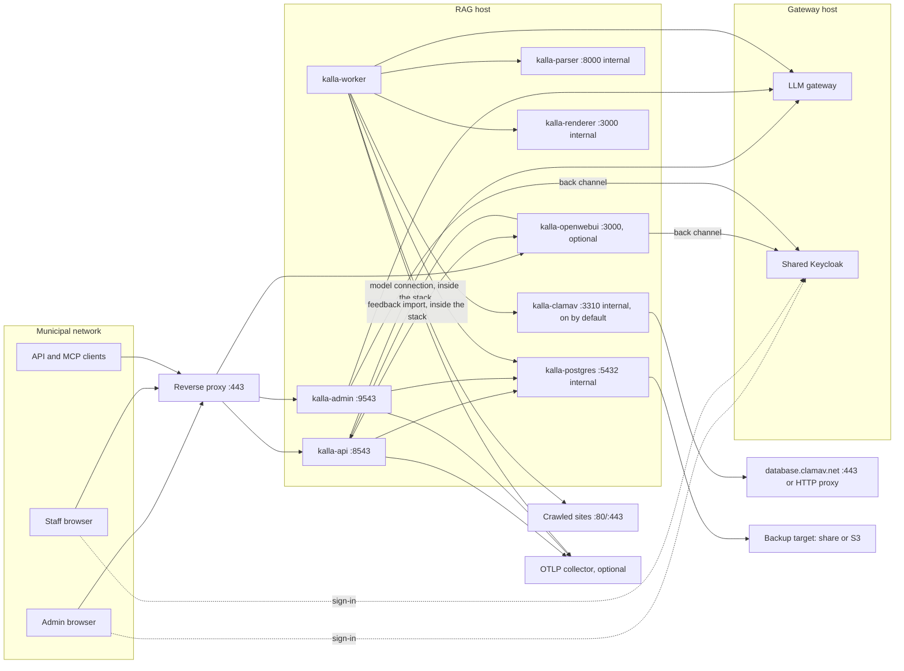

# Network and ports

This page is for the infrastructure and security teams that open ports and write firewall and proxy rules for
Källa. It lists every listener, every outbound destination and every container-internal port, per supported setup,
and says where each one is configured. Each rule cites the file it comes from. Where the repository doesn't set a
value, the page says **not set by Källa; agree with infra**.

Installation is in [production-setup.md](production-setup.md), operation (including the host firewall's commands) in
the [runbook](runbook.md), the units on the host in [`deploy/host/README.md`](../deploy/host/README.md). The design is
[`plans/platform/repo-and-deployment.md`](../plans/platform/repo-and-deployment.md) §6.1 (networks) and
[`plans/identity/design.md`](../plans/identity/design.md) (sign-in flows).

Everything is IPv4: the Compose networks have no IPv6 (`deploy/host/docker-user-firewall.sh`).

## 1. Components and hosts

| Component | Where | What it is to Källa |
|---|---|---|
| **RAG host** | one Linux host, Docker Compose project `kalla` (`deploy/compose.rag.yaml` and its overlays) | `kalla-postgres`, `kalla-api`, `kalla-admin`, `kalla-worker`, `kalla-parser`; `kalla-clamav` (profile `clamav`, on by default); with the profile `render`, `kalla-renderer`; with the profile `openwebui`, `kalla-openwebui`; with the profile `proxy`, `kalla-proxy` |
| **Gateway host** | Fors's host, run by the gateway team | the gateway (every model call, and the admin's organisation and model syncs), and in the pilot the **shared Keycloak** (realm `fors`). Källa reaches each by URL only |
| **Reverse proxy** | in front of the RAG host (and the gateway host): the municipal one, or the stack's own `kalla-proxy` (profile `proxy`) | terminates public TLS and re-encrypts to the RAG listeners |
| **Identity provider** | the shared Keycloak (pilot), a standalone Keycloak, or Entra ID / AD FS directly | OIDC for the admin UI and Open WebUI |
| **Crawled sites** | municipal hosts (private ranges) and public web sites | read by `kalla-worker` over HTTP(S) |
| **Backup target** | a share mounted on the RAG host, or an S3-compatible store | pgBackRest repository and the upload copy |
| **ClamAV signatures** | `database.clamav.net` (no internal mirror, Decisions "ClamAV updates"), or through an egress proxy | `freshclam` inside `kalla-clamav`; not reached without the profile `clamav` |
| **OTLP collector** (optional) | municipal monitoring | logs, metrics and traces of the .NET services |

The gateway repository publishes its own services on loopback by default and serves them through its proxy:
gateway `8443`, admin `9443`, Data API `10443` (gateway repo `deploy/compose.prod.yaml`), Keycloak `11443` (gateway repo
`deploy/keycloak/compose.yaml`). RAG's listeners use `8543` and `9543` so both stacks fit on one host
([compose-quick-start.md](compose-quick-start.md#1-before-you-start)). The ports RAG connects to
are the ones in the URLs it is given, not these.



## 2. Inbound to the RAG host

Two ports are published, four with `--rolling` (8544 and 9544), plus one per profile: Open WebUI's 3000 with
`openwebui`, the TLS proxy's 443 with `proxy` (`deploy/compose.rag.yaml`, `deploy/compose.rolling.yaml`;
repo-and-deployment §6.1: "Nothing else is published").

| Listener | Host port (default) | Container port | Protocol | Who connects | Purpose | Required | Configured by |
|---|---|---|---|---|---|---|---|
| `kalla-api` | `${KALLA_API_BIND}:${KALLA_API_PORT}`, `0.0.0.0:8543` | 8443 | HTTPS (TLS: internal CA, or your PKI's certificate in `KALLA_PKI_DIR`) | the reverse proxy only, on behalf of: API and MCP clients with `kalla-sk-` keys, staff browsers following citation download links | chat, retrieval, MCP (`Rag__Roles: knowledge,chat,mcp`), health | yes | `KALLA_API_PORT`, `KALLA_API_BIND` (`init-deployment.sh --set`) |
| `kalla-admin` | `${KALLA_ADMIN_BIND}:${KALLA_ADMIN_PORT}`, `0.0.0.0:9543` | 8443 | HTTPS (as above) | the reverse proxy only, on behalf of admins' browsers | admin UI and its BFF, OIDC redirects `/signin-oidc` and `/signout-callback-oidc`, uploads, health | yes | `KALLA_ADMIN_PORT`, `KALLA_ADMIN_BIND` |
| `kalla-api-b`, `kalla-admin-b` (only with `--rolling`) | `${KALLA_API_BIND}:${KALLA_API_B_PORT}`, `${KALLA_ADMIN_BIND}:${KALLA_ADMIN_B_PORT}`, `0.0.0.0:8544` and `:9544` | 8443 | as kalla-api and kalla-admin | the reverse proxy only | the second slots of [updates without downtime](zero-downtime-updates.md) | yes | `--rolling` |
| `kalla-openwebui` (profile `openwebui`) | `${KALLA_OPENWEBUI_BIND}:${KALLA_OPENWEBUI_PORT}`, `127.0.0.1:3000` | 8080 | **plain HTTP**: the proxy terminates TLS | the reverse proxy only, on behalf of staff browsers | the chat UI, OIDC callback `/oauth/oidc/login/callback` | optional | `KALLA_OPENWEBUI_PORT`, `KALLA_OPENWEBUI_BIND` |
| `kalla-proxy` (profile `proxy`) | `${KALLA_PROXY_BIND}:${KALLA_PROXY_PORT}`, `0.0.0.0:443` | 8443 | HTTPS with your certificate (`KALLA_PROXY_CERTS_DIR`) | browsers and clients | the stack's own TLS proxy, instead of a proxy of your own: it reaches kalla-api, kalla-admin and Open WebUI inside the stack | optional | `KALLA_PROXY_PORT`, `KALLA_PROXY_BIND` |

**Binding.** kalla-api and kalla-admin (and their second slots) are published on `0.0.0.0` by default, so they are
reachable from off the host unless something restricts them; Open WebUI is published on `127.0.0.1`. **The listeners
must be reachable only from the reverse proxy.** `KALLA_API_BIND`, `KALLA_ADMIN_BIND` and
`KALLA_OPENWEBUI_BIND` publish one on another address: `127.0.0.1` behind the stack's own `kalla-proxy`, which reaches
the services inside the stack; an address your proxy reaches, for Open WebUI behind a proxy of your own.

**How to restrict them.** Docker publishes these ports with DNAT, so the connections pass the `FORWARD` chain and
Docker's `DOCKER-USER` chain, not the host's `INPUT` chain: an `INPUT` rule (ufw, firewalld zones) does not restrict
them. With `--hardened`, `init-deployment.sh --proxy-address ADDR[,ADDR]` (the proxy's IPv4 addresses or CIDRs) writes
`KALLA_PROXY_SOURCES`, and `deploy/host/docker-user-firewall.sh` (run by `rag-firewall.service` at boot, when Docker
restarts and every 15 minutes) then rejects every new DNATed connection to `KALLA_API_PORT`, `KALLA_ADMIN_PORT`
and, with Open WebUI, `KALLA_OPENWEBUI_PORT` whose source is not one of them (#453):

```bash
-A UME-RAG-EGRESS -s <proxy address> -p tcp -m conntrack --ctstate DNAT --ctorigdstport 8543 -j RETURN
-A UME-RAG-EGRESS -p tcp -m conntrack --ctstate DNAT --ctorigdstport 8543 -j REJECT --reject-with icmp-admin-prohibited
```

(the same for 9543 and 3000, and for the second slots' 8544 and 9544 when `COMPOSE_FILE` lists `compose.rolling.yaml`,
[Updates without downtime](zero-downtime-updates.md)). It matches the original destination port of DNATed connections only, so container egress
is never affected; `kalla-proxy`'s port is not in the list. Without `--hardened`, or without `--proxy-address`, nothing
on the host limits who reaches the listeners: restrict them in a network firewall in front of the host instead, or
bind them to an address only the proxy reaches. A network firewall is still the better second layer. The rules are
checked by `iptables-restore --test` (iptables-nft); they have not run on a pilot host yet.

**Proxy routes.** `kalla-proxy` (profile `proxy`) has them built in (`deploy/proxy/nginx.portainer.conf.template`). For
a proxy of your own, `deploy/proxy/nginx.conf.example` has them: `https://<api host>` to `https://<upstream host>:8543`
and `https://<admin host>` to `https://<upstream host>:9543` (`<upstream host>`: the address the proxy reaches the RAG
host at), keeping the `Host` header; `client_max_body_size 60m` and
`proxy_request_buffering off` on `PUT /api/upload-batches/{batchId}/files/{n}` of the admin host, 2 MB on the api host (the chat route takes the
whole conversation), 1 MB elsewhere. The
proxy must trust the listeners' certificates (the internal CA, `ca.pem` in the `kalla-certs` volume, or your PKI), and
set `X-Forwarded-For`; add its
addresses to the trusted proxies in the admin UI (Settings, *Network*) so key IP allow-lists and security events see
the client's address ([production-setup.md](production-setup.md#reverse-proxy-and-pki)). Which kalla-api paths the proxy
exposes to whom (identity design §5.3): `GET /v1/documents/*` and `GET /v1/documents/*/content` to the staff network
(citation downloads); every other path only to the integration clients you have agreed (Open WebUI calls kalla-api inside
the stack, not through the proxy). Open WebUI's route is `https://<owui host>` to `http://<upstream host>:3000`, which
needs `KALLA_OPENWEBUI_BIND` set to an address the proxy reaches.

**Monitoring.** No metrics port is published. Health is `/health/live`, `/health/ready` and `/version` on the two
listeners (through the proxy, or on the host with `curl --cacert rag-ca.pem https://localhost:8543/...`, the internal
CA read out of the `kalla-certs` volume as [production-setup.md](production-setup.md#5-start) shows).
The backup scripts write Prometheus text files to `/var/lib/kalla/` for a local collector (`deploy/host/README.md`);
that collector's port (for example node_exporter's) is not set by Källa; agree with infra. Telemetry is pushed out
over OTLP (§3), never scraped.

**Host administration** (SSH and the like) is not set by Källa; agree with infra.

## 3. Outbound

### 3.1 Per Docker network

With `--hardened`, each Compose network has a fixed subnet (`deploy/compose.hardened.yaml`), and
`deploy/host/docker-user-firewall.sh` (run by `rag-firewall.service` after Docker starts and by `rag-firewall.timer`
every 15 minutes) gives each one an allow-list in chain `UME-RAG-EGRESS`, jumped to from `DOCKER-USER`. Without
`--hardened` the networks take subnets Docker chooses and no host firewall runs: a network that is not internal
reaches whatever the host reaches, and the table below is what the services use, for a network firewall to allow. A
container sends all its egress through the network that holds its default route, pinned with `gw_priority` in the
Compose file: kalla-api and kalla-admin leave through `llm`, kalla-worker through `kalla-crawl`. Destinations are host names
resolved when the script runs; the port is the URL's (443 for `https://` without a port, 80 for `http://`), and an
allow-listed endpoint is matched both by address and port and, when it is published on the RAG host itself, by its
original destination (`--ctorigdst`). Everything else from a network is rejected (`icmp-admin-prohibited`). New
connections from any RAG subnet to the host's own addresses are rejected in chain `UME-RAG-INPUT`, except
allow-listed endpoints that resolve to the host (a gateway or Keycloak on the same machine).

| Network (subnet with `--hardened`) | Members | Destination | Port, protocol | Purpose | When | Config key |
|---|---|---|---|---|---|---|
| `llm` (172.30.3.0/24) | kalla-api, kalla-admin (default route); kalla-worker is a member but leaves through `kalla-crawl` | the gateway, host of `KALLA_GATEWAY_URL` | the URL's port (443), HTTPS | every model call: chat, embeddings, rerank, model checks; kalla-admin's organisation and model syncs | always | `--gateway-url` → `Gateway__BaseUrl` |
| | | the gateway's Admin API, host of the context's `integration_api_url` | the URL's port (443; 9443 in the gateway's own Compose stack), HTTPS | kalla-admin's cost and budget read-back, `/integration/v1` (production-setup.md, *Cost and budget read-back*) | when the gateway names it | the gateway's `FORS_INTEGRATION_API_URL`; the firewall: `--allow llm=HOST:PORT` |
| | | the OIDC authority, host of `KALLA_OIDC_AUTHORITY` | the URL's port (443), HTTPS | kalla-admin's back channel: discovery, JWKS, token endpoint (code + PKCE). kalla-api validates no OIDC tokens yet (`RagApi:Authority` is not built, identity design §7.1) | always | `--oidc-authority` → `Oidc__Authority`; the firewall knows no provider set only in the setup wizard |
| | | the OTLP endpoint, `FORS_OTEL_ENDPOINT` | the URL's port, HTTP(S) | telemetry | optional | `init-deployment.sh --set FORS_OTEL_ENDPOINT=...` |
| | | DNS: the host's upstream resolvers | 53, UDP and TCP | name resolution through Docker's embedded DNS | always | `--dns IP` overrides |
| `kalla-crawl` (172.30.6.0/24) | kalla-worker (default route) | the gateway | the URL's port (443), HTTPS | embeddings, evaluation models, catalogue | always | `--gateway-url` |
| | | the OTLP endpoint | the URL's port | telemetry | optional | `FORS_OTEL_ENDPOINT` |
| | | `KALLA_CRAWL_ALLOW` (CIDRs) | any port, any protocol | municipal hosts in private ranges | when crawling municipal hosts | `--set KALLA_CRAWL_ALLOW=...` → also `Crawl__AllowedPrivateRanges` |
| | | every other private, loopback, link-local, CGNAT, documentation, multicast or reserved range | – | rejected | – | list in `docker-user-firewall.sh` (`private=`) |
| | | the rest of the Internet | any at the firewall; the worker itself fetches only `http`/`https` on 80 and 443 plus `Settings.Crawl.AllowedPorts` | public sites being crawled | always | `Settings.Crawl.AllowedPorts` (admin UI, run-time) |
| | | DNS | 53, UDP and TCP | | always | |
| `kalla-mirror` (172.30.7.0/24) | kalla-clamav (freshclam) | `database.clamav.net` | 443, HTTPS | signature updates, four times a day | with the profile `clamav` (the default), no proxy | `images/clamav/freshclam.conf` (`DatabaseMirror`) |
| | | **or only** freshclam's HTTP proxy, `KALLA_FRESHCLAM_PROXY` | the given `HOST:PORT` | the same through the proxy | with `--freshclam-proxy` | `--freshclam-proxy` |
| | | DNS | 53, UDP and TCP | | always | |
| `backup` (172.30.16.0/24) | kalla-postgres (pgBackRest) | the S3 endpoint, `KALLA_BACKUP_ENDPOINT` | 443 unless the endpoint names a port, HTTPS | WAL archive and backups | with an `s3://` target | `--backup-target s3://ENDPOINT/BUCKET[/PATH]` |
| | | nothing (all rejected) | – | a mounted share is written through the file system | with a share or `local` | `--backup-target DIR` |
| | | DNS | 53 | | with an `s3://` target | |
| `kalla-edge` (172.30.1.0/24) | kalla-api, kalla-admin, kalla-openwebui, kalla-openwebui-setup, kalla-proxy (Open WebUI's default route) | the OIDC provider, `KALLA_OPENWEBUI_OIDC_PROVIDER_URL`, else `KALLA_OIDC_AUTHORITY` | its port (443), HTTPS | Open WebUI's back channel: discovery, token, JWKS | with the profile `openwebui` | `--set KALLA_OPENWEBUI_OIDC_PROVIDER_URL=...` (default: the authority's discovery document); a provider set only in the setup wizard: `--allow kalla-edge=HOST` |
| | | DNS | 53 | | with the profile `openwebui` | |
| | | nothing else: it carries the published ports, kalla-proxy's upstreams, Open WebUI's model connection to kalla-api and kalla-api's feedback import from Open WebUI, all within the network | – | – | – | – |
| `kalla-data` (172.30.2.0/24), `kalla-ingestion` (172.30.4.0/24), `kalla-parser` (172.30.5.0/24), `kalla-render` (172.30.18.0/24) | see §4 | nothing (Docker `internal: true`, and rejected) | – | – | – | – |

Sources: `deploy/host/docker-user-firewall.sh` (allow-lists, DNS, `private=`, `INPUT`), `deploy/compose.rag.yaml`
and `deploy/compose.backup.yaml` (members, `gw_priority`), `deploy/compose.hardened.yaml` (subnets),
`src/Kalla.Worker/Connectors/Egress/EgressGuard.cs` (schemes and ports of the crawler).

**The organisation and model syncs.** kalla-admin reads the organisation, its assigned gateway keys and the model list
from the gateway itself, `GET /v1/fors/context` and `GET /v1/models` at `Gateway:BaseUrl`, with its credential key, which
holds the scope `organisation.read` ([production-setup.md](production-setup.md), *Gateway credential keys*;
`src/Kalla.AdminApi/OrganisationSync.cs`, `GatewayModelSync.cs`). They take the gateway's row of `llm` above. The
only other gateway service RAG calls is the gateway's Admin API, for kalla-admin's cost and budget read-back
(`/integration/v1`, with the same credential key and its scope `usage.read`; `src/Kalla.AdminApi/IntegrationApiClient.cs`),
and only while the gateway's context names its address (`integration_api_url`).

### 3.2 From the host itself

These leave from the host, not from a Compose network, so `docker-user-firewall.sh` doesn't filter them. Ports and
rules are not set by Källa; agree with infra:

- the backup share mounted on the host (`KALLA_BACKUP_DIR`, `KALLA_UPLOAD_BACKUP_DIR`), with its protocol (NFS,
  SMB);
- image pulls by Docker: the release's images are on `ghcr.io` (`ghcr.io/<owner>/kalla/<service>`), the Open
  WebUI image is `ghcr.io/open-webui/open-webui`, and `kalla-bootstrap`'s and `kalla-proxy`'s images are on Docker Hub
  (`docker.io/alpine/openssl`, `docker.io/nginxinc/nginx-unprivileged`; `deploy/compose.rag.yaml`); none if images come
  from an internal registry;
- the release bundle from GitHub releases ([production-setup.md](production-setup.md#1-files-and-images));
- DNS, NTP and OS updates.

### 3.3 Sign-in: browser flows and back-channel flows

Two kinds of traffic reach the identity provider, from different places:

| Flow | From | To | Port | Notes |
|---|---|---|---|---|
| Admin sign-in (browser) | the admin's browser | the IdP's authorization endpoint (host of `KALLA_OIDC_AUTHORITY`), then back to `https://<admin host>/signin-oidc` | 443 | code + PKCE; the IdP must be reachable from the admins' network |
| Admin sign-in (back channel) | kalla-admin, network `llm` | the IdP's discovery, JWKS and token endpoints | the authority URL's port | firewall `llm` rule |
| Open WebUI sign-in (browser) | the user's browser | the IdP, then `https://<owui host>/oauth/oidc/login/callback` | 443 | |
| Open WebUI sign-in (back channel) | kalla-openwebui, network `kalla-edge` | the provider URL's host: discovery, token, JWKS | the provider URL's port | firewall `kalla-edge` rule |
| Citation downloads (browser) | the user's browser | `https://<api host>/v1/documents/...` (absolute links from `Knowledge__PublicBaseUrl`) | 443 | through the proxy |

kalla-api and kalla-worker never call the IdP in this release. Open WebUI's user identity reaches kalla-api as a JWT signed
with a shared secret (`OpenWebUi__JwtSecret`), not through the IdP (identity design §5.3).

## 4. Internal only

These ports exist only inside Docker networks. None is published on the host, so **none should be opened on any host or
network firewall**. Check with `docker compose --env-file deploy/.env ps` (the `PORTS` column shows only the
listeners of §2) and `ss -ltnp`.

| Container | Port | Protocol | Network | Clients | Source |
|---|---|---|---|---|---|
| `kalla-postgres` | 5432 (image default) | PostgreSQL over TLS only (`hostnossl ... reject`), database `ragdb`, the four service roles, `scram-sha-256`; the superuser only over the Unix socket | `kalla-data` (internal) | kalla-migrate, kalla-api, kalla-admin, kalla-worker (`Host=kalla-postgres`, `SSL Mode=VerifyFull`) | `deploy/postgres/pg_hba.conf`, `deploy/postgres/postgresql.conf`, `deploy/portainer/bootstrap.sh` (connection strings) |
| `kalla-parser` | 8000 | HTTPS (internal CA, name `kalla-parser`) | `kalla-parser` (internal; its only network) | kalla-worker (`Parser__BaseUrl: https://kalla-parser:8000`) | `deploy/compose.rag.yaml`, `src/parser/Dockerfile` |
| NER (`ner-0`) | – | runs inside the parser container (`/v1/ner` on port 8000), not a container of its own | – | kalla-worker | `src/parser/ume_parser/api.py` |
| `kalla-clamav` (clamd) | 3310 | TCP, **no TLS and no authentication** | `kalla-ingestion` (internal) | kalla-worker (`ClamAv__Host: kalla-clamav`, `ClamAv__Port: 3310`, INSTREAM; not without the profile `clamav`, when the container doesn't run and `ClamAv__Mode` is `off`) | `images/clamav/clamd.conf` (`TCPSocket 3310`), `deploy/compose.rag.yaml` |
| `kalla-renderer` (Playwright `launch-server`, Chromium) | 3000 | WebSocket, **plain** (`ws://`), a secret path instead of TLS | `kalla-render` (internal; its only network) | kalla-worker (`Render__Endpoint`, a secret file: `ws://kalla-renderer:3000/<path>`) | `images/renderer/launch-server.json`, `deploy/compose.rag.yaml`, `deploy/portainer/bootstrap.sh` |
| `kalla-api`, `kalla-admin` | 8443 | HTTPS | `kalla-edge`, `kalla-data`, `llm` | the published host ports of §2; inside `kalla-edge`, kalla-proxy and (kalla-api) kalla-openwebui | `deploy/compose.rag.yaml` (`Kestrel__Endpoints__Https__Url`) |
| `kalla-worker` | 8443 | HTTPS | `kalla-data`, `llm`, `kalla-ingestion`, `kalla-parser`, `kalla-render`, `kalla-crawl` | none: not published; its health check runs inside the container | `deploy/compose.rag.yaml` |
| `kalla-openwebui` | 8080 | HTTP | `kalla-edge` | the published host port of §2; inside `kalla-edge`, kalla-proxy, kalla-api's feedback import and kalla-openwebui-setup | `deploy/compose.rag.yaml` |
| `kalla-proxy` | 8443 | HTTPS | `kalla-edge` | only through its published host port of §2 | `deploy/compose.rag.yaml` |
| `kalla-migrate` | – | one-shot client of kalla-postgres | `kalla-data` | – | `deploy/compose.rag.yaml` |
| `kalla-bootstrap`, `rag-upload-backup` | – | no network (`network_mode: none`) | – | – | `deploy/compose.rag.yaml`, `deploy/compose.backup.yaml` |
| Redis | – | none in the production Compose files (P2; the dev AppHost starts one only with `Redis:Enabled`) | – | – | `src/Kalla.AppHost/Program.cs` |

Docker keeps the bridge networks apart, and members of one network reach each other on it (the firewall returns
traffic within a subnet). `kalla-data`, `kalla-ingestion`, `kalla-parser` and `kalla-render` are `internal: true`, so they have
no route out at all. The renderer's Chromium runs the scripts of crawled pages: it is on `kalla-render` only, every
request it makes goes to the worker (which fetches it with the crawler's guard, from `kalla-crawl`), and with
`--hardened` the host firewall's `UME-RAG-INPUT` chain rejects the `kalla-render` subnet, because the bridge's gateway
address (the host) answers at the IP level (connectors design §8.3).

## 5. Per setup

### 5.1 Pilot: shared Keycloak and gateway on the gateway host

Decisions "P1 pilot sign-in" and "Gateway release 1 and shared Keycloak as built": Keycloak runs on the gateway's
host, realm `fors`, and RAG's clients come from `deploy/keycloak/rag-additions.json`.

- `KALLA_OIDC_AUTHORITY=https://<keycloak host>/realms/fors`; `KALLA_GATEWAY_URL=https://<gateway host>`.
- RAG host egress: `llm` → `<gateway host>:443` and `<keycloak host>:443`; `kalla-crawl` → `<gateway host>:443`;
  `kalla-edge` → `<keycloak host>:443` (with Open WebUI). All derived by the firewall from `deploy/.env`.
- Browsers: admins and staff → `<keycloak host>:443` and the proxy's RAG host names.
- The gateway host's own inbound (its proxy, Keycloak's port `11443` on loopback) belongs to the gateway team.
- **RAG on the gateway host itself** ([compose-quick-start.md](compose-quick-start.md)): the same rules; when the
  gateway's or Keycloak's name resolves to the host, the firewall's `UME-RAG-INPUT` and `--ctorigdst` exceptions let
  the RAG networks reach them ([compose-quick-start.md](compose-quick-start.md#when-something-fails) has the
  check). RAG's `8543`/`9543` don't clash with the gateway's `8443`/`9443`/`10443`/`11443`.

### 5.2 Standalone Källa with its own Keycloak

Decisions "Identity providers: AD and Entra ID through Keycloak, Källa standalone later". The repository ships only
the realm file (`deploy/keycloak/standalone/10-rag-realm.json`, applied with keycloak-config-cli as in
[`deploy/keycloak/README.md`](../deploy/keycloak/README.md#standalone)); it has no Compose file for Keycloak. Its
host, port, proxy route and database are **not set by Källa; agree with infra**.

- Point `KALLA_OIDC_AUTHORITY` (and Open WebUI's provider URL, which follows it) at that Keycloak; the firewall
  rules of §3 follow the new host. If it runs on the RAG host and its name resolves there, the `INPUT` exception covers
  it.
- Brokered Entra ID or AD (Keycloak as the broker): RAG's rules don't change. Keycloak's own egress (to
  `login.microsoftonline.com`, AD FS or LDAP) leaves from Keycloak's host: not set by Källa; agree with infra.

### 5.3 Entra ID or AD FS directly through `Oidc:*`

Switching is configuration, not code (production-setup.md, *Sign-in (OIDC)*).

- **Entra ID:** `--oidc-authority https://login.microsoftonline.com/<tenant>/v2.0`, and for Open WebUI
  `--set KALLA_OPENWEBUI_OIDC_PROVIDER_URL=https://login.microsoftonline.com/<tenant>/v2.0/.well-known/openid-configuration`
  with client `kalla-open-webui` (`--set KALLA_OPENWEBUI_OIDC_CLIENT_ID=kalla-open-webui`;
  `deploy/compose.rag.yaml`). The firewall then
  allows `login.microsoftonline.com:443` from `llm` and `kalla-edge`. It is a CDN-served name: the firewall resolves it
  every 15 minutes, and an address change can block sign-in until the next run (`deploy/host/README.md`). The browsers
  need `login.microsoftonline.com` and whatever else Microsoft's sign-in pages load: not set by Källa; agree with
  infra.
- **AD FS:** the authority is the AD FS issuer URL; the firewall allows its host and port. Its form is not set by
  Källa; agree with infra.
- The discovery document names the JWKS and token endpoints. If one is on another host than the authority, add it
  with `--allow llm=<host>` (and `--allow kalla-edge=<host>`).
- **No Microsoft Graph** in this release: Graph comes with P2 for the member-group lookup (repo-and-deployment §6.1,
  identity design §14).
- No Keycloak is needed, and nothing goes to the gateway host's Keycloak.

### 5.4 Open WebUI on the RAG host

Optional, off by default: the profile `openwebui` in the same Compose project (`deploy/compose.rag.yaml`); on the
24 GB host.

`kalla-openwebui` is on `kalla-edge` only and publishes `3000` on `127.0.0.1`. It calls kalla-api inside the stack
(`https://kalla-api:8443`), and kalla-api's feedback import calls it inside the stack (`http://kalla-openwebui:8080`), so
neither goes through the proxy. The proxy reaches it either inside the stack (`kalla-proxy`, profile `proxy`) or on the
published port, which then needs `KALLA_OPENWEBUI_BIND` set to an address the proxy reaches (and, with
`--proxy-address`, the host firewall admits only the proxy to it). Its only egress is its OIDC provider's back channel
on `kalla-edge` (§3.1).

Open WebUI's calls reach kalla-api directly on `kalla-edge`, not through the proxy, so kalla-api sees kalla-openwebui's own
address.

### 5.5 Ingestion

`deploy/compose.rag.yaml` always runs kalla-worker and kalla-parser; kalla-clamav runs with the profile `clamav` (the
default), kalla-renderer with the profile `render`.

- The `kalla-crawl`, `kalla-mirror`, `kalla-ingestion`, `kalla-parser` and `kalla-render` rules of §3 and §4 apply: egress to
  crawled sites, to `database.clamav.net` (or the proxy) and to the gateway from `kalla-crawl`. Without the profile
  `clamav` no `kalla-clamav` runs, so nothing uses `kalla-mirror` and the worker sends nothing to port 3310; files are
  stored without a malware scan (production-setup.md, *Malware scan*). The firewall still writes the `kalla-mirror`
  rules; they match nothing.
- **Ingestion on its own host** (P2, repo-and-deployment §6.4): planned, not built (`compose.ingestion-remote.yaml`
  doesn't exist). It would publish Postgres `5432` on the data host's LAN address for the ingestion host only.

### 5.6 freshclam directly or through a proxy

- **Directly** (default): `kalla-mirror` → `database.clamav.net:443`, nothing else.
- **Through a proxy:** `--freshclam-proxy HOST:PORT` has `kalla-bootstrap` write `HTTPProxyServer`/`HTTPProxyPort` into
  a copy of `freshclam.conf` in `kalla-config`, which `deploy/compose.clamav-conf.yaml` mounts, and the firewall lets
  `kalla-mirror` reach only that proxy. The proxy then needs `database.clamav.net:443`. Recommended where IT has an
  egress proxy (production-setup.md, *ClamAV signatures*), since the CDN's addresses change.

### 5.7 Test host

[test-host.md](test-host.md): the same as the pilot, with `--hardened`, `--proxy-address`, `--host-memory 24` and
`--freshclam-proxy`. Listeners on `0.0.0.0:8543` and `0.0.0.0:9543`, restricted to the proxy by the host firewall
(§2); its own host names (`rag-api-test...`, `rag-admin-test...`), redirect URIs, gateway keys and backup path. Egress
as §3.

### 5.8 Local development

The Aspire AppHost's ports (services `7401`–`7404`, containers `7410`–`7417`, admin UI `5174`, dashboard `17470`) are
for developers on their own machines and are never opened on a server firewall. See
[local-development.md](local-development.md).

## 6. Checklist for the firewall and proxy request

Replace the placeholders; with `--hardened` the RAG host's firewall script derives its own egress rules from
`deploy/.env`, so these are the rules **outside** the host (network firewalls, the proxy) plus the published-port
restriction. Without `--hardened` the outbound rules below are the only ones.

```text
Inbound to <rag host>
  [ ] <proxy> -> <rag host>:8543/tcp   HTTPS   kalla-api        (only from the proxy)
  [ ] <proxy> -> <rag host>:9543/tcp   HTTPS   kalla-admin      (only from the proxy)
  [ ] <proxy> -> <rag host>:3000/tcp   HTTP    kalla-openwebui  (optional; only from the proxy, with KALLA_OPENWEBUI_BIND)
  [ ] <clients> -> <rag host>:443/tcp  HTTPS   kalla-proxy      (only with the profile proxy, instead of a proxy of your own)
  [ ] everything else to <rag host> closed, apart from host administration (agree with infra)
  [ ] published ports restricted to <proxy> in DOCKER-USER or a network firewall (not INPUT/ufw)

Reverse proxy
  [ ] https://<api host>   -> https://<rag host>:8543  (Host header kept, X-Forwarded-For set, 2 MB body limit)
        staff network: GET /v1/documents/* and /v1/documents/*/content only
        agreed integration clients: all paths
  [ ] https://<admin host> -> https://<rag host>:9543  (60m and no request buffering on PUT /api/upload-batches/{batchId}/files/{n})
  [ ] https://<owui host>  -> http://<rag host>:3000   (optional)
  [ ] the proxy trusts the internal CA (ca.pem in the kalla-certs volume) or the PKI certificates of the listeners
  [ ] the proxy's addresses entered as trusted proxies in the admin UI

Outbound from <rag host>
  [ ] -> <gateway host>:<gateway port, 443>/tcp          HTTPS  always
  [ ] -> <gateway admin host>:<admin API port, 443>/tcp  HTTPS  with the cost and budget read-back
  [ ] -> <oidc authority host>:443/tcp                    HTTPS  always (Keycloak, Entra or AD FS; Open WebUI's too)
  [ ] -> <dns resolvers>:53/udp+tcp                       always
  [ ] -> <crawled public sites>:80,443/tcp                ingestion (plus Settings.Crawl.AllowedPorts)
  [ ] -> <municipal ranges in KALLA_CRAWL_ALLOW>:80,443/tcp  ingestion
  [ ] -> database.clamav.net:443/tcp, or <freshclam proxy>:<port>/tcp  with the profile clamav
  [ ] -> <s3 endpoint>:443/tcp, or the backup share's protocol to <backup host>  always
  [ ] -> <otlp collector>:<port>/tcp                      optional
  [ ] -> ghcr.io:443/tcp, docker.io:443/tcp               image pulls, unless an internal registry is used

Browsers on the municipal network
  [ ] -> <admin host>, <owui host>, <api host>:443  (through the proxy)
  [ ] -> <oidc authority host>:443                    sign-in

Never opened
  [ ] 5432 (kalla-postgres), 8000 (kalla-parser), 3310 (clamd), 3000 (renderer), 8443 (container ports)
```

## 7. Where each port and destination is configured

Change a value in the place in the first column; the others follow from it. A re-run of `init-deployment.sh` changes
what its options name and keeps the rest of `deploy/.env`. After a change of `deploy/.env`:
`docker compose --env-file deploy/.env up -d` and, with `--hardened`, `sudo systemctl start rag-firewall.service`.

| Value | Set with | Written to | Read by |
|---|---|---|---|
| kalla-api host port (8543) | `init-deployment.sh --set KALLA_API_PORT=N` | `KALLA_API_PORT` | `deploy/compose.rag.yaml` `ports`, the firewall |
| kalla-admin host port (9543) | `--set KALLA_ADMIN_PORT=N` | `KALLA_ADMIN_PORT` | `deploy/compose.rag.yaml` `ports`, the firewall |
| Bind address of the listeners (`0.0.0.0`; Open WebUI `127.0.0.1`) | `--set KALLA_API_BIND=ADDR` (and `KALLA_ADMIN_BIND`, `KALLA_OPENWEBUI_BIND`, `KALLA_PROXY_BIND`) | the same variables | the Compose `ports` |
| Open WebUI host port (3000) | `--set KALLA_OPENWEBUI_PORT=N` | `KALLA_OPENWEBUI_PORT` | `deploy/compose.rag.yaml` `ports`, the firewall |
| kalla-proxy host port (443) | `--set KALLA_PROXY_PORT=N` | `KALLA_PROXY_PORT` | `deploy/compose.rag.yaml` `ports` |
| Container port 8443 of the .NET services | fixed | `Kestrel__Endpoints__Https__Url` in the Compose file | the services and their `--health-check`; don't change |
| Open WebUI container port 8080 | fixed (the image) | – | `deploy/compose.rag.yaml` |
| Postgres 5432 | fixed (image default) | connection strings `Host=kalla-postgres` (`deploy/portainer/bootstrap.sh`) | the services |
| Parser 8000 | fixed | `Parser__BaseUrl` in `deploy/compose.rag.yaml` | kalla-worker |
| clamd 3310 | fixed | `images/clamav/clamd.conf` (`TCPSocket`), `ClamAv__Port` in `deploy/compose.rag.yaml` | kalla-worker |
| Renderer 3000 and its secret path | fixed port; the path generated once by `kalla-bootstrap` (`kalla-secrets/.render-ws-path`) | `images/renderer/launch-server.json` (`port`), `kalla-secrets/renderer/ws-path` (the renderer's entrypoint passes it on as `KALLA_RENDER_WS_PATH`), `kalla-secrets/worker/Render__Endpoint` | kalla-renderer, kalla-worker |
| Gateway URL | `--gateway-url` | `KALLA_GATEWAY_URL` | `Gateway__BaseUrl` (api, admin, worker), the firewall (`llm`, `kalla-crawl`) |
| Gateway Admin API (cost and budget read-back) | the gateway's `FORS_INTEGRATION_API_URL` (its context's `integration_api_url`); `docker-user-firewall.sh --allow llm=HOST:PORT` | none in Källa | kalla-admin's Integration API client, the firewall (`llm`, by `--allow`) |
| OIDC authority | `--oidc-authority`, or the setup wizard | `KALLA_OIDC_AUTHORITY` (the wizard's: the database) | `Oidc__Authority` (admin; api for Open WebUI's default provider URL), the firewall (`llm`, and `kalla-edge` without a provider URL; only `KALLA_OIDC_AUTHORITY`) |
| Open WebUI's OIDC provider | `--set KALLA_OPENWEBUI_OIDC_PROVIDER_URL=URL`, or the setup wizard | `KALLA_OPENWEBUI_OIDC_PROVIDER_URL` (empty: the setup wizard's, else the default) | `OpenWebUi__Oidc__ProviderUrl` (api, admin), which kalla-api serves to Open WebUI's start wrapper as `OPENID_PROVIDER_URL`; the firewall (`kalla-edge`) |
| Open WebUI's sign-in internal route | fixed | none | kalla-api's `/internal/openwebui/sign-in` (the managed Open WebUI client's key only); Open WebUI's `KALLA_SIGN_IN_URL`, `https://kalla-api:8443/...` inside the stack |
| kalla-api's public URL | `--domain` or `--api-host`; `--set KALLA_API_PUBLIC_URL=URL` for a port or a path | `KALLA_API_PUBLIC_URL` (default `https://<api host>`) | `Knowledge__PublicBaseUrl`, kalla-admin's `Admin__ApiPublicUrl` (the address in *How to connect*) |
| Open WebUI host | `--domain` (`chat.<domain>`) or `--set KALLA_OPENWEBUI_HOST=HOST` | `KALLA_OPENWEBUI_HOST` | Open WebUI's `WEBUI_URL` and `OPENID_REDIRECT_URI`, kalla-admin's `OpenWebUi__PublicUrl`, kalla-proxy's server block |
| Open WebUI's address for the feedback import | fixed, while the profile `openwebui` is on | `kalla-secrets/api/OpenWebUi__BaseUrl` (`http://kalla-openwebui:8080`, by `kalla-bootstrap`) | kalla-api's feedback import |
| Reverse proxy sources | `--proxy-address` | `KALLA_PROXY_SOURCES` | the firewall: the published ports accept only these |
| OTLP endpoint | `--set FORS_OTEL_ENDPOINT=URL` | `FORS_OTEL_ENDPOINT` | `OTEL_EXPORTER_OTLP_ENDPOINT` (api, admin, worker), the firewall (`llm`, `kalla-crawl`) |
| Trace sampling | `--set FORS_OTEL_TRACES_SAMPLER=...`, `--set FORS_OTEL_TRACES_SAMPLER_ARG=...` | `FORS_OTEL_TRACES_SAMPLER` (`parentbased_traceidratio`), `FORS_OTEL_TRACES_SAMPLER_ARG` (`0.1`) | `OTEL_TRACES_SAMPLER`, `OTEL_TRACES_SAMPLER_ARG` (api, admin, worker) |
| Municipal crawl ranges | `--set KALLA_CRAWL_ALLOW=CIDR[,CIDR]` | `KALLA_CRAWL_ALLOW` | `Crawl__AllowedPrivateRanges` (worker), the firewall (`kalla-crawl`) |
| Extra crawl ports | admin UI | `Settings.Crawl.AllowedPorts` (database) | the worker's egress guard |
| freshclam proxy | `--freshclam-proxy` | `KALLA_FRESHCLAM_PROXY`, `kalla-config/clamav/freshclam.conf` (with `compose.clamav-conf.yaml`) | freshclam, the firewall (`kalla-mirror`) |
| Malware scan | `--profiles` (with or without `clamav`) | the profile `clamav` in `COMPOSE_PROFILES`; `kalla-secrets/worker/ClamAv__Mode` (by `kalla-bootstrap`) | `ClamAv__Mode` (worker); whether `kalla-clamav` runs |
| S3 backup endpoint | `--backup-target s3://...` | `KALLA_BACKUP_ENDPOINT`, `kalla-secrets/pgbackrest/repo.conf` | pgBackRest, the firewall (`backup`) |
| Subnets | fixed, with `--hardened` | `deploy/compose.hardened.yaml`'s `networks` | `docker-user-firewall.sh` (`--subnet` when they differ) |
| One more destination, other resolvers | `--allow NETWORK=HOST[:PORT]`, `--dns IP` | a drop-in for `rag-firewall.service` (`systemctl edit`, [runbook](runbook.md#host-firewall)) | `docker-user-firewall.sh` |
