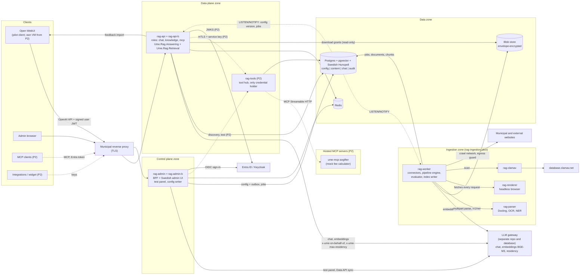
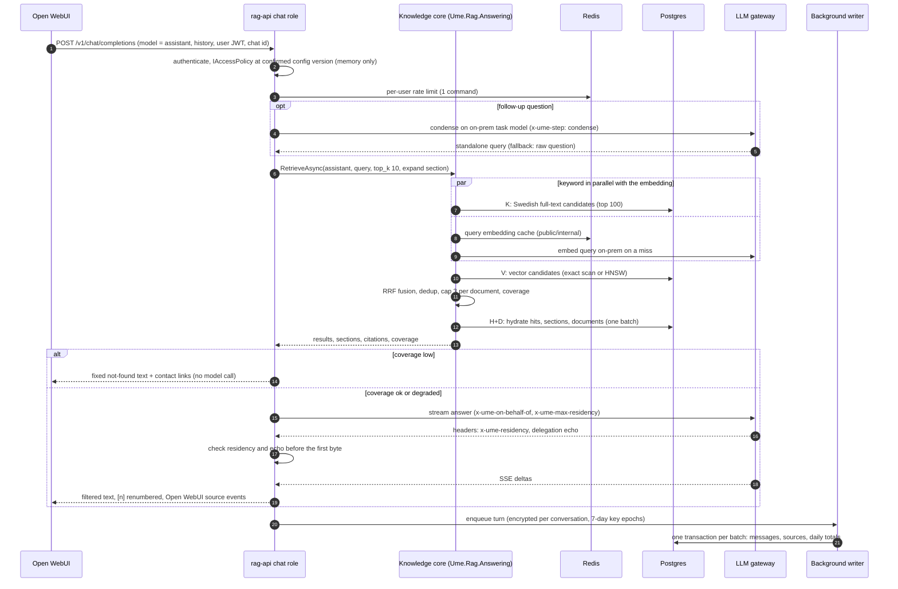
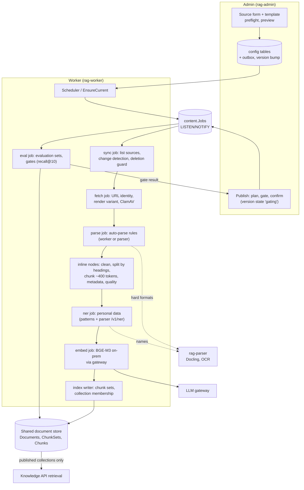
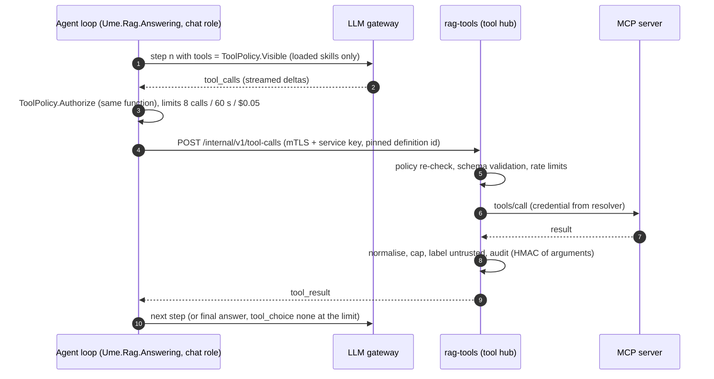

# Architecture diagrams

Mermaid views of the Ume.Rag design as it stands after the consistency pass. Sources: networks and containers
[`platform/repo-and-deployment.md`](platform/repo-and-deployment.md) §6, data ownership
[`platform/data-model.md`](platform/data-model.md), request paths [`chat-api/design.md`](chat-api/design.md) §4,
[`knowledge-api/design.md`](knowledge-api/design.md) §6, ingestion
[`ingestion-worker/design-engine.md`](ingestion-worker/design-engine.md), tools [`tools/design.md`](tools/design.md) §2.
Where a diagram and a document differ, the document wins.

## 1. System overview

Dashed boxes and edges marked P2 are not in the pilot.

## 2. Chat request (RAG assistant, P1)

## 3. Ingestion and publishing

## 4. Tool call from an agent assistant (P2)

