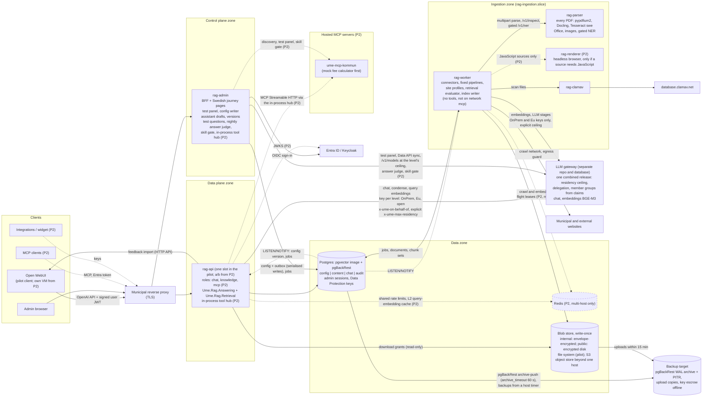
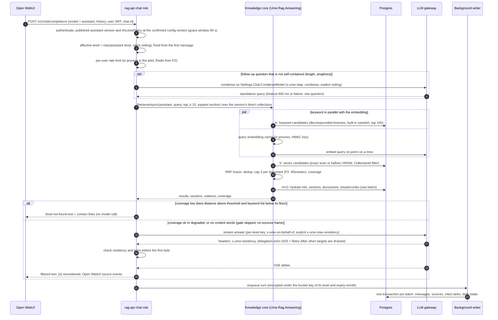
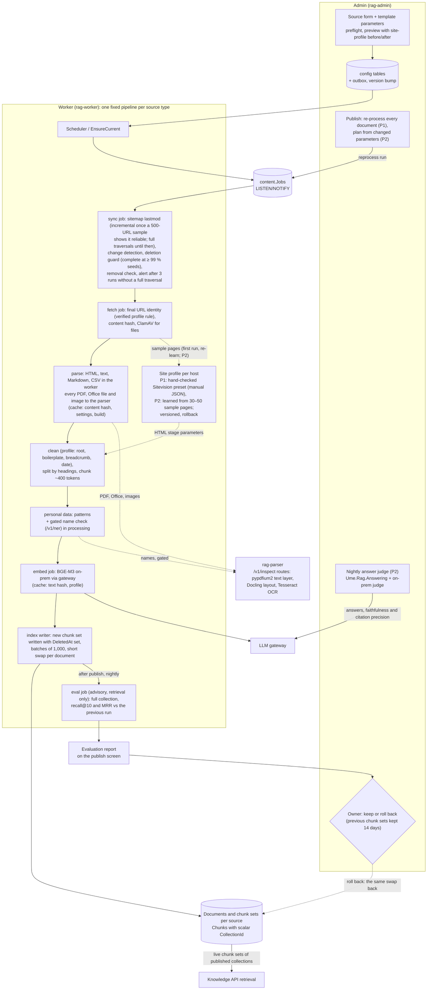
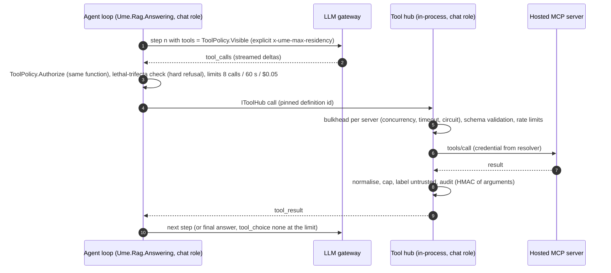

# Architecture diagrams

Mermaid views of the Ume.Rag design as it stands after the simplification pass
([`simplification-pass.md`](simplification-pass.md)) and the P1 split of the
[weakness review §1](weakness-review.md#1-p1-builds-a-platform-before-anyone-sees-one-good-answer). Sources: networks and containers
[`platform/repo-and-deployment.md`](platform/repo-and-deployment.md) §6, data ownership
[`platform/data-model.md`](platform/data-model.md), request paths [`chat-api/design.md`](chat-api/design.md) §4,
[`knowledge-api/design.md`](knowledge-api/design.md) §6, ingestion
[`ingestion-worker/design-engine.md`](ingestion-worker/design-engine.md), tools [`tools/design.md`](tools/design.md) §2.
Where a diagram and a document differ, the document wins.

## 1. System overview

Dashed edges and boxes marked P2 are not in the pilot. The pilot runs six long-running containers (rag-api, rag-admin,
rag-worker, rag-parser, rag-clamav, postgres) plus the one-shot rag-migrate; Redis arrives with the first multi-host
deployment (P2).

The zones are one host in the pilot, with one slot per service and an announced maintenance window for updates. From
the first multi-host deployment (P2, [`performance-pass.md`](performance-pass.md) §5) the same images run per host by
role, Compose per host: three hosts in P2 (**D** data: Postgres, Redis, object store; **A** data plane and control;
**I** ingestion), five in P3 (D; **A1/A2** rag-api and rag-admin; **F** fetch: worker
`preview,command,sync,fetch,eval`, clamd, small parser, renderer if needed; **P** processing: worker `parse,embed` with
its own parser). A Postgres streaming standby is required before production beyond the pilot (register D1). Parser,
renderer and clamd stay host-local to their worker; all hosts share the one Postgres, Redis and object store over a
routed LAN with TLS. In the pilot, rate limits and the query-embedding cache are in process and admin sessions are in
Postgres. A separate `rag-tools` service (mTLS hop, own database role) comes only with the first external,
OBO or write tool (P3).

## 2. Chat request (RAG assistant, P1)

Every assistant without a tool-bearing skill takes this path; chat serves the assistant's published version, and
retrieval searches only the collections that version links directly (simplification pass §15).

## 3. Ingestion and publishing

## 4. Tool call from an agent assistant (P2)

An assistant runs this loop when its published version links a skill with tools; the mode is derived from its skills,
not chosen (simplification pass §15). The tool hub runs in-process in the chat role (`IToolHub`), and in `rag-admin`
for discovery, the test panel and the skill gate; never in the worker. Skills totalling ≤ about 4k tokens are included statically
with their tools visible from step 1, and `search_knowledge` is prefetched with the user question.

