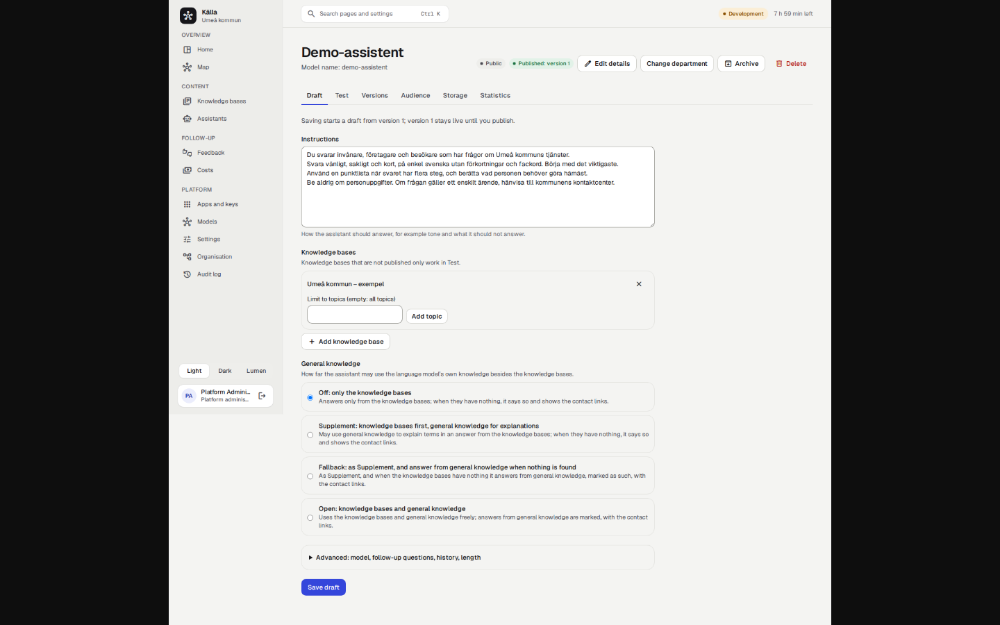
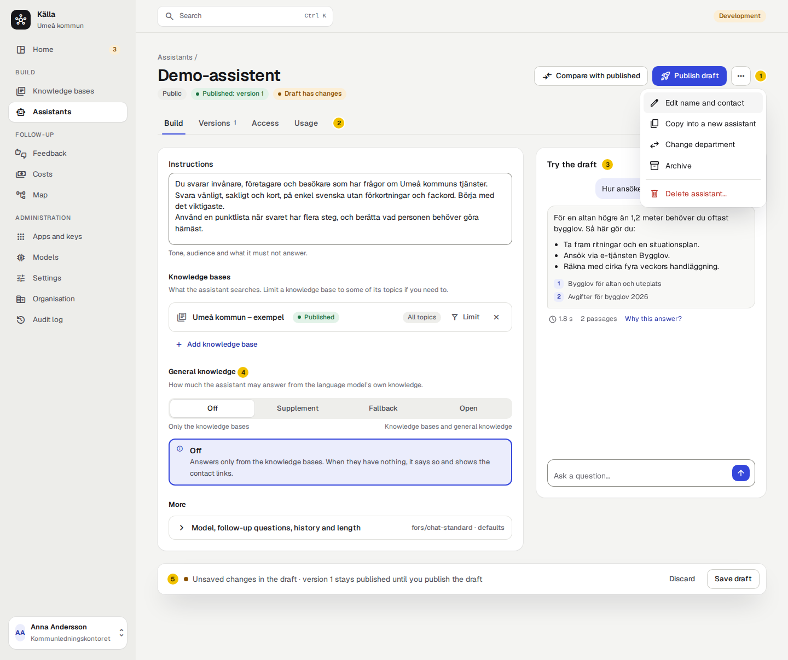
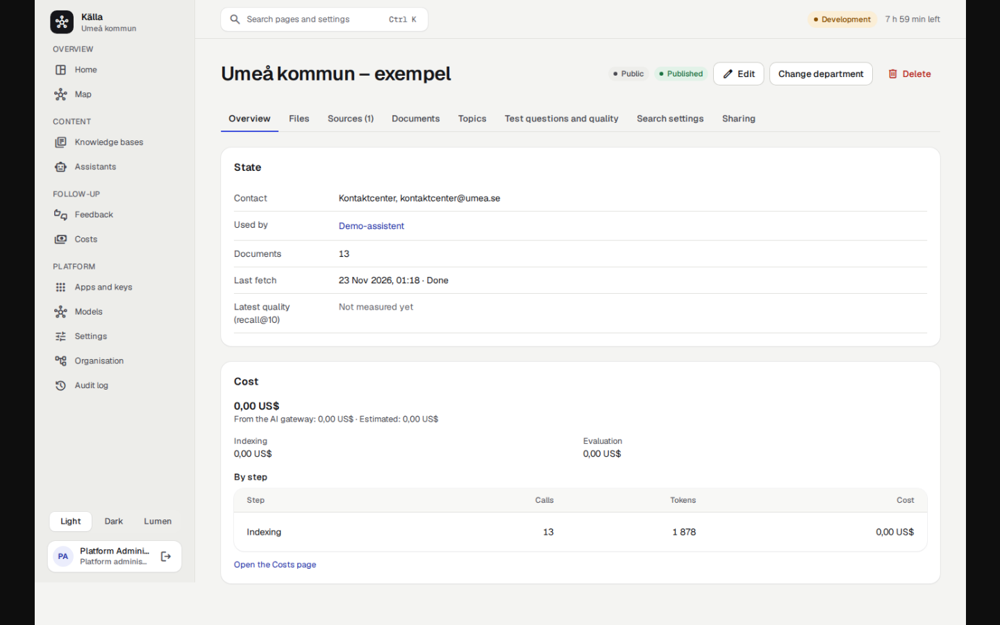
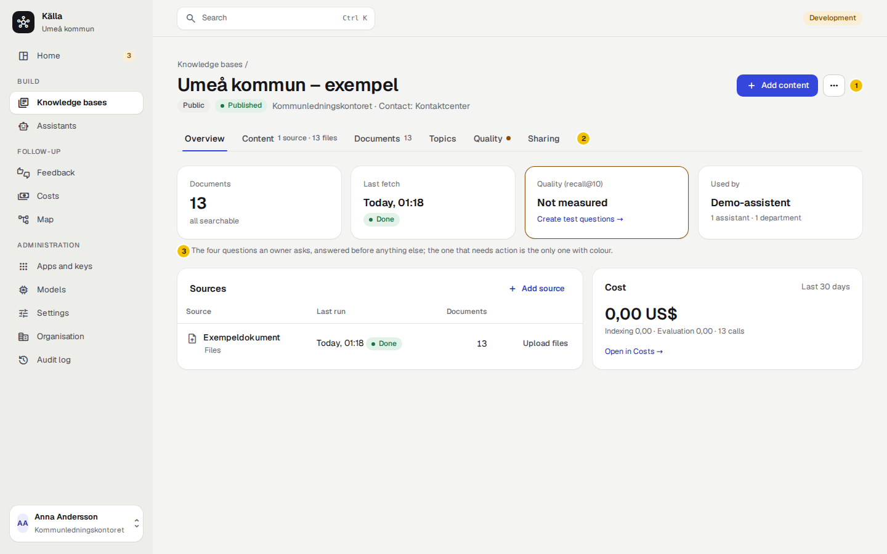
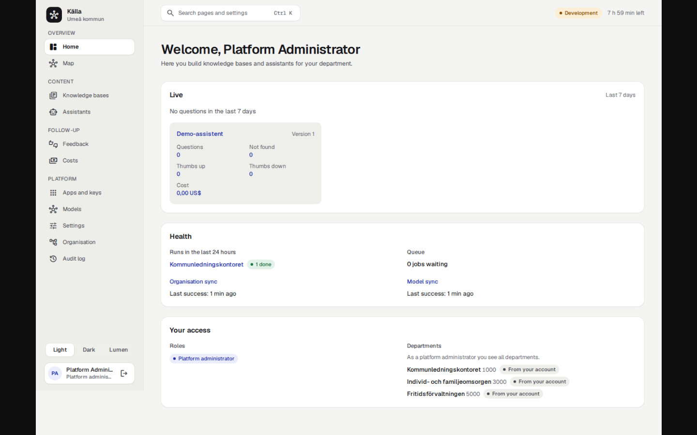
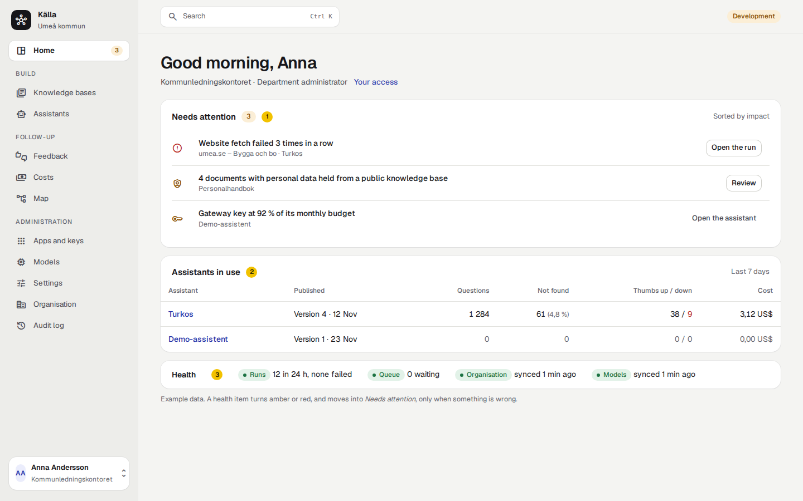
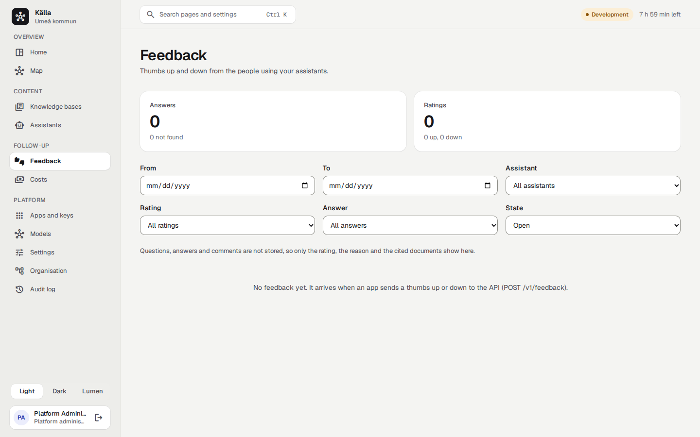
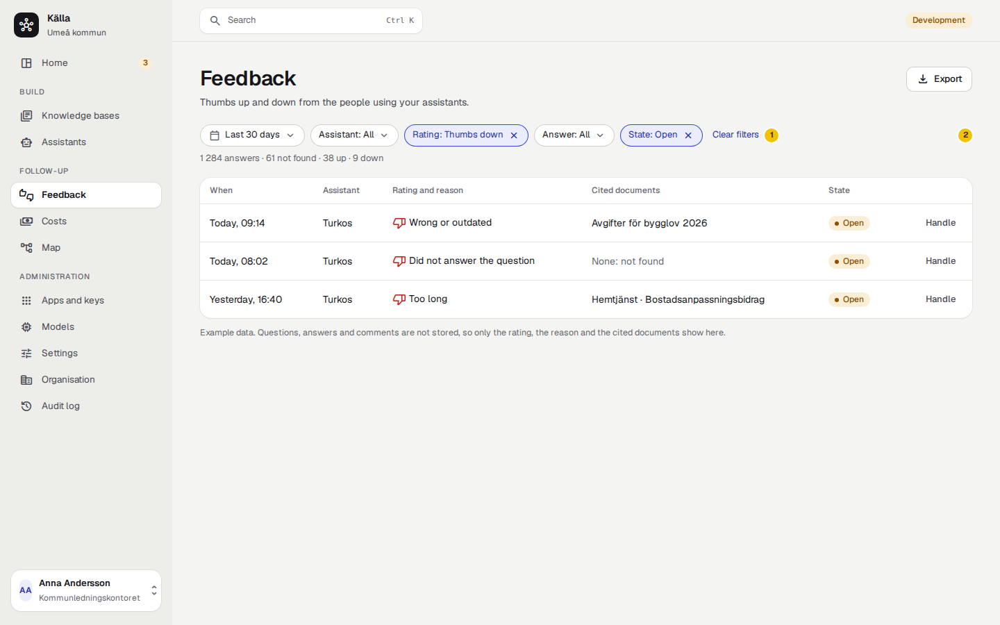
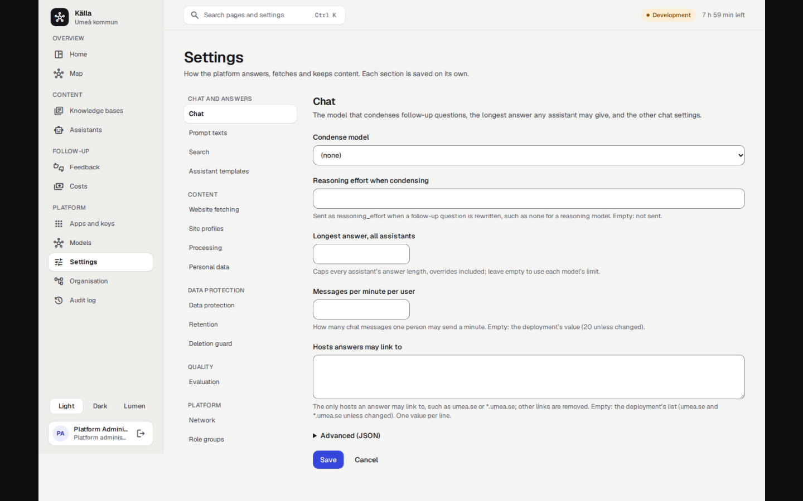
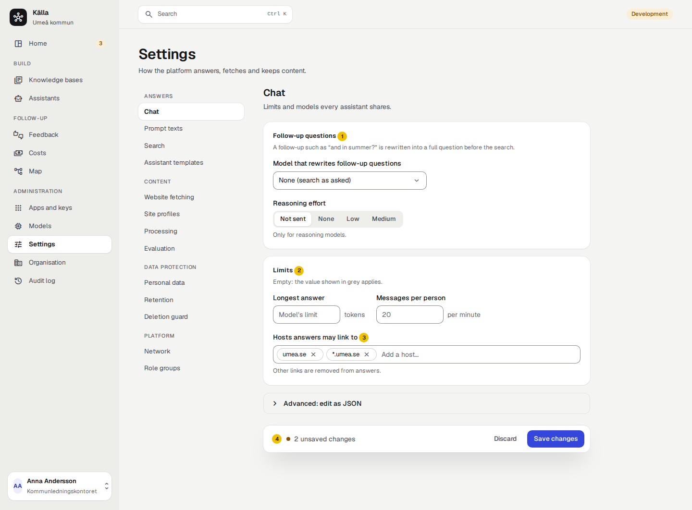

# Admin UI: a UX pass over every page

**Status:** **proposal**, for review. Nothing here binds until the user picks options and the main session moves the
rules into Decisions "Admin API and UI" and admin design §5. Written by the main session, 2026-11-23, after a review of
every admin page in a browser on `main` at `9f48c107` (the code of `v0.9.2` plus plan files). Follows
[`admin-ui-review.md`](admin-ui-review.md) (M-19, built in `v0.6.0`), which fixed Home, the lists, the audit log and
the assistant page's wording; this pass looks at layout, grouping, placement and names across all pages.

**The brief** (user, 2026-11-23): keep the style; look at forms, inputs, menu options, groupings and placement, and
make the UI easy to use, with the eye led to the right place. A Nordic look: clean, calm and expensive rather than
crowded. A plan with the reasons, and a visual example; the implementation comes after the review.

## In short

The style is already right: the tokens, type, cards and colours are calm and consistent, and nothing in this
proposal changes them. What makes pages feel busy is **how much asks for attention at once**:

- every header shows three to five buttons at the same weight, with a red *Delete* always in view;
- filters are built as forms (six labelled fields stacked above the data on Feedback and the Audit log);
- inputs stretch across 1,100 px for a number of two digits;
- the knowledge base has eight tabs and the assistant six, some of them holding a single field;
- the assistant's test is a separate tab from the draft it tests, so you switch tabs after every edit;
- each form saves with a differently named button at its bottom, and nothing says that there are unsaved changes.

The proposal is nine rules (below) and six decisions (UX1–UX6), each with a recommendation. Together they take most
of the buttons and form fields off the first screen of the busiest pages, without removing a single function.

## How the review was done

46 screens at 1,440 px as a platform administrator: every page in the menu, every tab of a knowledge base and an
assistant, every Settings section, a source page, and the create and edit drawers. The stack was the FakeGateway stack
with the demo seed (one knowledge base with 13 files, one published assistant, four departments); the parser,
renderer and Open WebUI were off. Phone width and the dark and Lumen themes were reviewed in M-19 and are not repeated
here; every proposal below must keep the phone layout (rows as cards, the bottom menu) and all three themes.

The mockups under [`admin-ui-ux-pass/mockups/`](admin-ui-ux-pass/mockups/) are plain HTML that use the admin UI's own
tokens (`tokens.css`, light theme), so they show layout and grouping, not a new look. Yellow numbered dots in them
point to the numbered items in the text. Their data is invented where the seed has none (feedback, attention items).

## What stays

- **The design system**, copied from Fors (`design-system.lock`): tokens, `main.css`, type, radii, shadows, buttons,
  badges, tabs, drawers. No proposal here needs a change to a file marked `unchanged` in the lock; where one would
  help (the theme switch, UX1 B), it is proposed to Fors first.
- **The wording conventions** (admin design §5.7): plain English, verbs on buttons, the glossary. Renames below stay
  within the glossary.
- **The drawers** for create and edit, the command palette (Ctrl K), the empty states, `?tab=` in the address.

## Nine rules

These are the rules each change below follows; once adopted they go into admin design §5 as the layout rules every
new page is reviewed against.

1. **One primary action per view.** A filled button only for the one thing the page is for (*Create knowledge base*,
   *Publish draft*, *Save changes*). Other frequent actions are secondary (outlined). Rare and destructive actions go
   in a **⋯ menu** on the right of the header, *Delete* last and in red, behind its confirmation.
2. **Data first, controls second.** A list page shows its list on the first screen. Filters are one compact row of
   chips above the list; a filter that is set is coloured, one that is not is quiet.
3. **A field is as wide as its answer** (GOV.UK's text-input guidance). Numbers 8–12 characters, names and selects
   about 320–400 px, free text up to the form's width. A form column is at most 680 px.
4. **Group by the question people ask, not by the data model.** "Is it working?", "What does it search?", "Who can
   use it?", "What does it cost?" each get one place.
5. **Say it once.** Text that repeats on every row ("Not scanned for malware", *Replace*) goes into the summary or
   onto the row's menu.
6. **At most six tabs, each a noun people recognise**; a tab that holds one or two fields joins another (NN/g, *Tabs,
   used right*).
7. **One way to save.** A form shows a save bar at its bottom, sticky while the form is longer than the window:
   *n unsaved changes · Discard · Save changes*. The bar names the consequence when there is one ("version 1 stays
   published until you publish the draft").
8. **Colour only for what needs attention.** Zeros, "none" and "not yet" are grey text, not accent links or badges.
   Green is for a state someone waits for (*Published*, *Done*); amber and red for something to do.
9. **One rhythm.** Lists use the full content width; forms one column of at most 680 px, with help or a preview in a
   second column when there is room; detail pages start with a row of up to four summary tiles.

## Before and after

### Assistant: build and test side by side (UX3, UX4)

| Now | Proposed |
|---|---|
|  |  |

1. *Publish draft* is the one primary action, beside *Compare with published* (B-56's diff); *Edit name and contact*,
   *Copy* (B-55), *Change department*, *Archive* and *Delete* move into the ⋯ menu.
2. Six tabs become four: **Build** (the draft and its test), **Versions**, **Access** (today's *Audience* and
   *Storage*, plus *Check access* and the model name apps call it by), **Usage** (today's *Statistics*: questions,
   not found, feedback and cost).
3. The test panel sits beside the draft, sticky, as a short chat with the cited documents and *Why this answer?*. You
   edit, ask, and read the answer without switching tabs.
4. The four *General knowledge* levels become one scale (*Off → Open*) with the chosen level's description below it,
   instead of four cards of near-identical text.
5. The save bar replaces *Save draft* at the bottom of the form, and says what saving means.

### Knowledge base: answers first (UX2, UX4)

| Now | Proposed |
|---|---|
|  |  |

1. *Add content* (a website, addresses or files) is the primary action; *Edit name and contact*, *Change department*
   and *Delete* are in the ⋯ menu.
2. Eight tabs become six: **Overview**, **Content** (today's *Sources* and *Files*), **Documents**, **Topics**,
   **Quality** (today's *Test questions and quality* and *Search settings*), **Sharing**. A dot on a tab marks
   something to do there.
3. The Overview opens with four tiles: documents, last fetch, quality, used by. The one that needs action has the only
   coloured border. Sources and cost follow as compact cards; the *State* list of label–value rows goes.

### Home: what needs me, then what runs (UX6)

| Now | Proposed |
|---|---|
|  |  |

1. *Needs attention* (B-59) on top, one row per item with its action button.
2. *Assistants in use* as one table row per published assistant instead of a third-width tile each; it scales to
   twenty assistants. Zeros are grey.
3. *Health* is one line of four green states; an item that fails turns amber or red and moves into *Needs attention*.
   *Your access* (roles and departments) becomes a link under the greeting and an entry in the user menu.

### Lists: filters as one row (UX5)

| Now | Proposed |
|---|---|
|  |  |

1. Six labelled fields become a row of chips: a period chip with presets (*Last 7 days*, *Last 30 days*, *This
   month*, *Custom…*) replaces the two date fields, which today show the browser's `mm/dd/yyyy` while the rest of the
   UI writes "23 Nov 2026". A set filter is blue with an ×; *Clear filters* shows only when one is set.
2. The two summary tiles become one line of counts at the end of the filter row. *Export* moves to the header.

### Forms: sized fields and one save bar (UX5, rule 3 and 7)

| Now | Proposed |
|---|---|
|  |  |

1. Fields are grouped under a heading and one sentence that says what the group is for.
2. Numbers are short fields with their unit after them (*tokens*, *per minute*); the value in force shows as the
   placeholder (M-19 already does this in places).
3. A list of hosts is a chip input, not a text area with one value per line.
4. The save bar; ✱ *Cancel* becomes *Discard*, which says what it does.

## Decisions for the user

### UX1: Side menu

Today: *Overview* (Home, Map) · *Content* (Knowledge bases, Assistants) · *Follow-up* (Feedback, Costs) · *Platform*
(Apps and keys, Models, Settings, Organisation, Audit log), and a Light / Dark / Lumen switch above the user card. Map
and Models share the `hub` icon (also the logo's).

| Option | Gain | Cost |
|---|---|---|
| **A.** Home alone at the top (with B-59's badge); **Build**: Knowledge bases, Assistants; **Follow-up**: Feedback, Costs, Map; **Administration**: the platform pages. Models gets its own icon (`memory`) | The groups say what you do there; Map sits with the other follow-up views; one icon per page | `router/nav.ts`, `platform/nav.ts`, `labels.ts` (`NAV_GROUP`); admin §5.2's sketch |
| **B.** A, plus the theme switch moves into the user menu (the card at the bottom opens it; *Your access* and *Sign out* live there too) | Three fewer controls always in view | `AppShell.vue` is adapted from Fors: propose it to Fors first so both shells stay alike |
| **C.** A, with *Assistants* above *Knowledge bases* | Puts the thing people deliver first | Against the journey of §5.4 (knowledge base first) and the setup checklist |
| **D.** Leave the menu | Nothing to do | Two pages keep one icon; *Overview* is a group of two unrelated pages |

**Recommendation: A now, and B proposed to Fors** (the gateway's shell has the same switch).

### UX2: Knowledge base page

| Option | Gain | Cost |
|---|---|---|
| **A.** Six tabs: *Overview*, *Content* (sources as cards on top, the file list of an upload source below; §5.5.7's drop zone and list unchanged), *Documents*, *Topics*, *Quality* (test questions, latest evaluation, then search settings under *Tune the search*), *Sharing* | Fewer tabs; the files and the sources that hold them in one place; quality and its tuning together | Changes §5.5.2's tab list and §5.5.7 point 2 (the *Files* tab, user 2026-11-09): the files stay one click from the page, but under *Content* |
| **B.** Only *Quality* merged (seven tabs); *Files* stays its own tab | Keeps 2026-11-09's *Files* tab as it is | Sources and files stay two tabs for the same thing on an upload-only knowledge base |
| **C.** A, plus the Overview as four tiles (documents, last fetch, quality, used by) and a tab dot for what needs action, as in the mockup | The page answers "is it working?" before anything else | One overview component; the tiles read data the page already loads |
| **D.** Leave the eight tabs | Nothing to do | — |

**Recommendation: C.** The source page keeps its files card for a deep link, but stops repeating the upload help.

### UX3: Assistant page

| Option | Gain | Cost |
|---|---|---|
| **A.** Four tabs: *Build* (draft and test side by side), *Versions*, *Access* (audience, storage, *Check access*, the model name), *Usage*; *Publish draft* in the header | Edit, ask and publish without leaving the first tab | §5.5.4's wireframe and tab list; the test panel becomes a column (it already tests the draft) |
| **B.** Only the test panel beside the draft; the six tabs stay | The biggest gain for the least change | *Audience* and *Storage* stay tabs with one or two fields |
| **C.** A, plus *General knowledge* as one scale with the chosen level's description, and the knowledge bases as rows with *Limit to topics* behind a button | The form fits on one screen beside the test | One small segmented control from the existing `SegmentedControl`; works with B-65's read-only Topics field |
| **D.** Leave it | Nothing to do | — |

**Recommendation: C.** It keeps M-19's UI4 B (the form stays open, the lead says what saving does), so nothing
decided is undone. Below 1,280 px the test panel folds under the form as a *Try the draft* card.

### UX4: Actions in headers and rows

Today the knowledge base header has *Edit*, *Change department* and *Delete*; the assistant's *Edit details*,
*Change department*, *Archive* and *Delete*; the source page *Fetch now* and *Delete*; every file row a *Replace*
button.

| Option | Gain | Cost |
|---|---|---|
| **A.** One primary action and a ⋯ menu per header, as rule 1 | The eye lands on the next step; *Delete* is no longer always in view | A `MenuButton` component in Källa (built from the tokens, `UiButton` and the drawer's focus handling); Fors may take it later |
| **B.** Keep the buttons; make *Delete* a quiet ghost button and move *Change department* into the edit drawer | Smaller change | Headers stay at three or four buttons |
| **C.** A, plus row actions on a row ⋯ (file rows: *Replace*, *Download*, *Delete*), and the bulk bar shown only when rows are selected | Rows read as data, not as forms | The same component in `DataTable` rows and `FileRows` |
| **D.** Leave them | Nothing to do | — |

**Recommendation: C.** A *Fetch now* on an upload source does nothing useful and goes; a crawl source keeps it as its
primary action.

### UX5: Filters and form fields

| Option | Gain | Cost |
|---|---|---|
| **A.** Filters as one row of chips with a period chip (presets and a custom range), *Clear filters* when one is set, export in the header: Feedback, Costs, Audit log, Map, the lists' search; fields sized by rule 3 in every form and drawer | Data on the first screen; the same filter pattern everywhere; no `mm/dd/yyyy` | Reverses M-19's "labels above, even widths" for the filters (2026-11-15); a `FilterChip` and a `PeriodPicker` in Källa |
| **B.** Keep labelled fields, one row, with the rarer filters under *More filters* | Smaller change | Still a form above every list |
| **C.** A, plus the filters kept in the address (`?period=30d&rating=down`), so a filtered view can be linked and survives a reload | Links to "this week's thumbs down" can be shared; back and forward work | A small composable used by the four pages (Costs already reads its department from it) |
| **D.** Leave them | Nothing to do | — |

**Recommendation: C.**

### UX6: Saving and Home

| Option | Gain | Cost |
|---|---|---|
| **A.** The save bar of rule 7 on every form (assistant draft, search settings, sharing, audience, storage, each Settings section); the buttons named *Save changes* and *Discard*; leaving a page with unsaved changes asks first | One way to save; nothing lost by a tab change | A `SaveBar` component and a dirty check per form; today's per-tab button names go from `labels.ts` |
| **B.** Only the names made the same (*Save changes*), no bar | Cheap | Unsaved changes stay invisible |
| **C.** A, plus Home as in the mockup: *Needs attention* (B-59) on top, *Assistants in use* as a table, *Health* as one line, *Your access* behind a link | Home shows what needs you, then what runs | Home's layout in §5.5.1 changes; the data is the existing `/api/overview` and B-59's list |
| **D.** Leave them | Nothing to do | — |

**Recommendation: C.**

## Page by page

What changes on each page beyond the decisions, all within rules 1–9. ✱ marks a rename (`labels.ts`).

### Shell and every page

- The top bar's search placeholder says what it finds: ✱ *Search pages, knowledge bases and assistants*.
- A breadcrumb above a detail page's title (*Knowledge bases /*), so the way back is visible; the menu item stays lit.
- Section titles inside the card they title, everywhere (the source page has *Runs* and *Personal data* outside
  their cards, *Files* and *Processing* inside).
- One content width per page type (rule 9): today forms sit in columns of 768 px (the assistant's draft), 896 px
  (*Sharing*) or the full width (*Search settings*, Settings), with nothing beside them.
- Technical text goes behind *Details* or into the place it belongs: the empty Feedback state's
  "(POST /v1/feedback)", ✱ the assistant's subtitle "Model name: demo-assistent" (to *Access*, with a copy button),
  `system:seed` as a person (✱ *Demo data*), the monospaced knowledge-base name in the *Add source* drawer's subtitle.
- Radio cards show which one is chosen: a 2 px accent border and the soft accent background (`shadow-inset-selected`
  and `bg-accent-soft`, both already in the Tailwind config). Today only the small dot changes.

### Home

UX6 C. ✱ The greeting uses the person's first name ("Good morning, Anna") and the line under it their department and
role; today it is "Welcome, Platform Administrator" over a sentence about building knowledge bases.

### Knowledge bases (list)

- The search field loses its label above (✱ placeholder *Search by name*, `aria-label` kept) and sits on the tabs'
  row, right-aligned; the list moves up by 90 px.
- ✱ Column *Information class* → *Class* (it wraps today); *Last fetch* shows "Today, 01:17" for today.

### Knowledge base

UX2 C, UX4 C. In *Content*: the summary line and progress bar stay; "Not scanned for malware" shows once in the
summary ("13 files not scanned for malware: the scan is off in this deployment") instead of on each row; each row
is name, folder, size, state, uploaded, and a ⋯. *Topics* is B-64/B-65's and only takes the tab position. In
*Quality*, the search settings' seven fields become two short rows of number fields (rule 3) under *Tune the search*,
with *Try without saving* beside the save bar.

### Source

- Header: the source's primary action by type (crawl: *Fetch now*; upload: *Upload files*), the rest in ⋯.
- Order: what it fetches (address list, schedule, processing) → runs → files (upload) → held and quarantined.
- ✱ The *Personal data* heading over *Kept documents* and *Quarantine* is wrong (neither is about personal data):
  ✱ *Held and quarantined*, with the personal-data holds in it once B-63 lands.

### Assistants (list)

The model column in plain text (not monospaced); a draft with changes marked in the *Published* column ("Version 1 ·
draft has changes").

### Assistant

UX3 C, UX4 C. *Versions* gets *Compare* per row (B-56) and *Restore* behind the row ⋯. *Access* reads top-down as one
story: who can use it (the summary), the apps that offer it (checkboxes), then *Check access* folded as a tool for
when something is wrong. *Usage* holds *Statistics*' cost card plus questions, not found and ratings for the period.

### Create and edit drawers

- *Create knowledge base*: the order follows the decision people make: name → what goes in (*Files I upload* /
  *A website or addresses*) → who may read it → department and contact, with the contact pre-filled and folded into
  one line ("Contact: Anna Andersson, anna@… · Change").
- *Create assistant*: *Start from* as three template cards with one line each, not a select over a paragraph; the
  department select gets the placeholder *Choose a department* (it is empty today).
- *Add source*: the type cards on top, then only that type's fields; *Sitemaps* and the advanced crawl fields
  folded under *More options*.
- Every drawer's primary button names the result (*Create knowledge base*, *Save and fetch*); this is mostly true
  today and stays.

### Feedback, Costs, Audit log, Map

UX5 C. Costs: ✱ *CSV rows per Day / Month* becomes *Export* with *By day* and *By month* in its menu; the department
card's total sits in the card title's row. Audit log: *Who* and *Type of object* stay as chips; *Service* and the
object filter move under *More filters*. Map: the two selects become chips; B-67's *Table / Drawing* switch goes on
the same row, right-aligned.

### Organisation

✱ *Knowledge bases shared* (three phrases per row today) becomes *Knowledge bases* with "1 own · 0 shared"; *Member
groups* "No member groups" as a grey dash; *Fetched* drops the date when it is today.

### Apps and keys, Models

- Apps and keys: ✱ *Enabled* "Yes" as a badge only when it is *Off*; *Last used* "Never used" grey.
- Models: the three cards (AI gateway, Embedding profiles, Embedding canary) become two tabs, ✱ *Models* (the
  gateway's model table, the page's main content, first) and ✱ *Embedding* (profiles and canary); the gateway's
  version and features move into a small *AI gateway* card at the top or the Details of *Settings → Network*. The
  test models of the FakeGateway (`fake-*`) are hidden behind *Show test models* when the gateway is the fake.

### Settings

- ✱ Groups: *Answers* (Chat, Prompt texts, Search, Assistant templates), *Content* (Website fetching, Site profiles,
  Processing, Evaluation), *Data protection* (Personal data, Retention, Deletion guard), *Platform* (Network, Role
  groups). *Personal data* moves to *Data protection*; *Evaluation* leaves its group of one.
- Every section: groups with a heading and one sentence, fields sized by rule 3, the save bar.
- *Website fetching* shows its settings as fields (allowed ports as a chip input, the rest typed); the JSON editor
  stays under ✱ *Advanced: edit as JSON* in every section, as it does on Chat.

## What this is not

- **Not a new look.** No token, font, radius, colour or icon set changes.
- **Not the phone layout.** It keeps M-19's: each proposal folds to one column, the ⋯ menu becomes a bottom sheet,
  the save bar stays at the bottom.
- **Not new functions.** Every function on today's pages is still there, at most one click further away when it is
  rare.

## Where it lands

- **Design:** Decisions "Admin API and UI" (the nine rules, one line each); admin design §5.2 (menu), §5.3, §5.5.1
  (Home), §5.5.2 and §5.5.7 point 2 (knowledge base tabs), §5.5.4 (assistant), §5.7 (the renames), §5.10 (Settings
  groups).
- **Code:** `src/admin-ui/src/**` (stream b's paths); four new Källa components in `components/ui/` (`MenuButton`,
  `FilterChip` with `PeriodPicker`, `SaveBar`, `SummaryTile`), built from the existing tokens and not added to the
  design-system lock.
- **Overlaps with queued work:** B-55 (*Copy* goes in the ⋯ menu), B-56 / #954 (*Compare* in the header and in
  *Versions*), B-59 (*Needs attention* is Home's top card), B-64 and B-65 (*Topics* keeps its tab), B-67 (the Map's
  switch in the filter row), B-68 (*Archive* and *Keep* in the ⋯ menu), #953 (the organisation logo in the menu's
  brand). None waits on this proposal; the later step adapts to what has landed.
- **Order** (each a pull request of its own, smallest first):
  1. Rules 3, 5, 8 and the renames: field widths, grey zeros, repeated texts, radio-card selection (about a day).
  2. UX4: `MenuButton`, the headers and the file rows.
  3. UX6 A: `SaveBar` on every form.
  4. UX3: the assistant page.
  5. UX2: the knowledge base page.
  6. UX5: filters and the address.
  7. UX1 and Home (UX6 C) once B-59 has landed.
- **Checks:** each step shown in a browser at 1,440 and 390 px in the three themes; the accessibility spec
  (`tests/e2e`) and the menu-structure test (`router/*.spec.ts`) updated with the step that changes them.

## Sources

- GOV.UK Design System, [Text input](https://design-system.service.gov.uk/components/text-input): fixed-width
  inputs sized to the expected answer.
- Nielsen Norman Group, [Tabs, used right](https://www.nngroup.com/articles/tabs-used-right/) and
  [Progressive disclosure](https://www.nngroup.com/articles/progressive-disclosure/): few tabs with clear labels;
  rare and advanced options a step away.
- European Commission component library, [Tabs: usage](https://ec.europa.eu/component-library/eu/components/navigation/tabs/usage):
  don't hide what must always be visible in a tab.
- Skatteetaten (built on Digdir's Designsystemet),
  [Text field](https://www.skatteetaten.no/en/stilogtone/designsystemet/komponenter/textfield/): a visible label, not
  a placeholder alone, which is why the filter chips and the search keep an `aria-label`.
